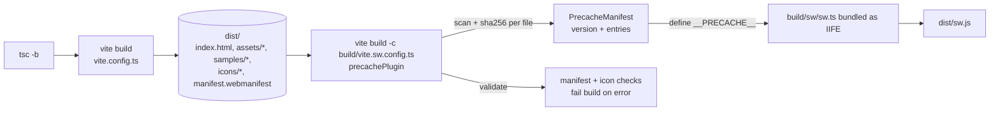
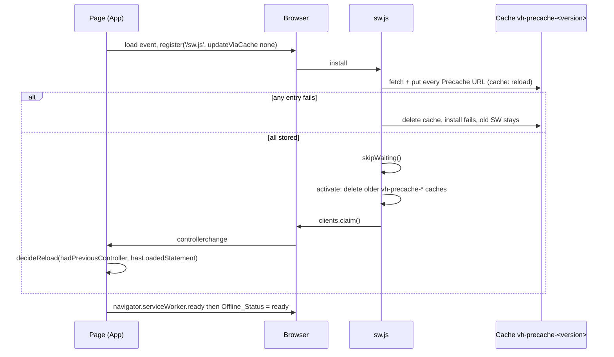

# Design Document

## Overview

Vampire Hunter promises "your bank data never leaves your computer". Today a Content-Security-Policy (`connect-src 'self'`) enforces that promise, but nobody can see it. This feature makes it visible and testable:

1. **Offline support.** A hand-written service worker precaches every built file, the 5 sample CSVs and the manifest with its icons. After one visit the whole app works with no network. A web manifest makes the app installable.
2. **Privacy seal.** A small button shows three measured facts: connections to other servers (Resource Timing), offline readiness, and current online state. A non-modal "How do we know?" panel explains the CSP and states only what is measured.
3. **Verification.** Vitest unit and property tests cover all pure logic. A Playwright check runs against the real production build and the real headers from `customHttp.yml`.

### Key design decisions

| Decision | Choice | Why |
| --- | --- | --- |
| Service worker generation | Small custom Vite config plus plugin (`build/`), no `vite-plugin-pwa` or Workbox | See "Build-time generation" below. No new runtime dependency, exact install semantics, all logic unit-testable. |
| CSP | No change | `worker-src` and `manifest-src` fall back to `script-src 'self'` and `default-src 'self'`. See "CSP analysis". |
| Per-path headers | Multiple `pattern` rules in `customHttp.yml`; pure parser/matcher in `build/headerRules.ts`; Vite preview middleware | `npm run preview` then matches Amplify per path. |
| Update strategy | Cache named by content version, `skipWaiting` after a complete precache, `clients.claim`, delete older caches on activate, reload once only when safe | Meets Requirement 4 and protects a loaded statement. |
| Reload rule | Pure `decideReload()` | First visit never reloads. Testable. |
| Seal disclosure | Non-modal: `aria-expanded` button plus region, no focus trap, no focus move | Requirement 10.1 and 11.6. |
| Counting | Pure `connectionCounter` over URL strings, deduplicated by URL | Requirement 7. Honest: only what Resource Timing reports. |
| WebSocket | Never claimed as monitored | Resource Timing does not report WebSocket connections. The CSP is what restricts them. |

### Research summary

- **CSP fallbacks.** MDN documents that when `worker-src` is absent the browser looks at `child-src`, then `script-src`, then `default-src` ([worker-src](https://developer.mozilla.org/en-US/docs/Web/HTTP/Reference/Headers/Content-Security-Policy/worker-src)). `default-src` is the fallback for all other fetch directives ([default-src](https://developer.mozilla.org/en-US/docs/Web/HTTP/Reference/Headers/Content-Security-Policy/default-src)). Our policy sets `script-src 'self'` and `default-src 'self'`, so `/sw.js` and `/manifest.webmanifest` are already allowed.
- **Resource Timing buffer.** The spec requires an initial buffer of at least 250 entries, and `setResourceTimingBufferSize()` raises it ([MDN](https://developer.mozilla.org/en-US/docs/Web/API/Performance/setResourceTimingBufferSize)). A `PerformanceObserver` with `buffered: true` replays earlier entries ([MDN](https://developer.mozilla.org/en-US/docs/Web/API/PerformanceObserver/observe)).
- **Resource Timing and WebSocket.** Resource Timing lists resources fetched by the page (fetch, XHR, images, scripts, CSS, fonts). It does not report WebSocket connections. The seal therefore must not claim WebSocket monitoring (Requirements 7.19, 8.8, 10.12).
- **Amplify headers.** `customHttp.yml` uses glob `pattern` entries. In Amplify a single `*` matches one path segment and `**` matches any depth ([Amplify docs](https://docs.aws.amazon.com/amplify/latest/userguide/setting-custom-headers.html)). How Amplify handles overlapping patterns (whether matching rules merge, or one wins) is unverified: the docs do not settle it and it was not tested against a live deployment. The design avoids depending on it by never repeating a header name across rules (see "Per-path header rules"), and a post-deploy checklist with `curl -sI` confirms `Cache-Control` and the CSP per path (see "Post-deploy verification checklist").
- **`vite preview` behavior (measured in this repo).** With the current config, `vite preview` serves its own `Cache-Control: no-cache` on static files and returns `index.html` with HTTP 200 for unknown paths. Static `preview.headers` are applied to every response. Both facts shape the header design below.

Content was rephrased for compliance with licensing restrictions.

## Architecture

### Build-time generation (item a)

The build is two Vite invocations. The second one reads the finished `dist/` and emits `dist/sw.js`.



`package.json` scripts:

```json
{
  "build": "tsc -b && vite build && vite build --config build/vite.sw.config.ts",
  "test": "vitest run",
  "test:build": "npm run build && vitest run --config vitest.build.config.ts",
  "test:e2e": "npm run build && playwright test"
}
```

`amplify.yml` keeps running `npm run build`, so Amplify gets the service worker with no config change. It does not run the Playwright check, which keeps deploys fast.

**Plugin steps (`build/precachePlugin.ts`):**

1. `config` hook: list every file under `dist/` recursively, skip `sw.js` and dotfiles, convert each path to a URL like `/assets/index-abc.js`, compute `sha256(bytes)` per file. This list is the Precache. No file list is kept by hand (Requirement 4.2).
2. Build a `PrecacheManifest` with the pure `computeCacheVersion(entries, sha256)` from `src/engine/precache.ts`. The version is the first 16 hex characters of the SHA-256 of a canonical string: entries sorted by URL, one `url\0hash\n` line each. Same content gives the same version, any changed file gives a different one (Requirement 4.1).
3. Return `define: { __PRECACHE__: JSON.stringify(manifest) }`. The manifest is inlined into `sw.js`, so two builds with different Precache content produce byte-different scripts. That is what makes the browser detect an update (Requirement 4.13).
4. `buildStart` hook: run `checkWebManifest()` and `readPngSize()` on every icon the manifest references. Any mismatch throws with the offending icon entry, which fails the build (Requirement 5.6).

`build/vite.sw.config.ts` sets `publicDir: false`, `build.emptyOutDir: false`, `build.lib` with `formats: ['iife']`, entry `build/sw/sw.ts`, output file `sw.js` at the root of `dist/`. The name is stable (no hash) because the browser must fetch the same URL every time.

**Why a custom plugin instead of `vite-plugin-pwa` / Workbox:**

- *No new dependency.* The workspace tech rules favor a small footprint. `vite-plugin-pwa` pulls `workbox-build`, which brings a large transitive tree into the build chain. A custom plugin is about 100 lines plus a 80-line worker, using only Node built-ins and Vite.
- *Exact install semantics.* Requirements 1.6, 4.3 and 4.4 want one cache per version, install failure if any file fails, and deletion of the partial cache. Workbox precaching shares one cache across versions and updates entries incrementally, which does not match.
- *CSP safety.* Some Workbox/PWA plugin modes inject an inline registration script. We register from the bundled app code instead.
- *Testability.* The version, routing, stale-cache and request logic are pure functions in `src/engine/` that fast-check can test. The worker file only wires them to browser events.
- *Cost accepted.* We own about 200 lines of service worker code. They are small and fully covered by tests.

Rejected alternative: a nested `build()` call inside a `closeBundle` hook of the main config. It works, but the two-step script is easier to debug and has no hook-ordering risk with Vite 8.

### Runtime flow



### CSP analysis (item b)

Current policy (unchanged):

```
default-src 'self'; script-src 'self'; style-src 'self'; img-src 'self' data: blob:;
font-src 'self'; connect-src 'self'; object-src 'none'; base-uri 'self';
form-action 'self'; frame-ancestors 'none'
```

| Feature part | Governing directive | Resolved source | Allowed? |
| --- | --- | --- | --- |
| `navigator.serviceWorker.register('/sw.js')` | `worker-src` absent, then `child-src` absent, then `script-src` | `'self'` | Yes |
| Manifest fetch (`<link rel="manifest">`) | `manifest-src` absent, then `default-src` | `'self'` | Yes |
| Manifest icons (PNG, same origin) | `img-src` | `'self'` | Yes |
| Fetches made by the worker | The CSP delivered with the `sw.js` response (catch-all `**` rule applies to `/sw.js`) | `connect-src 'self'` | Yes, and it keeps the worker from contacting other origins |
| Object URL for `.ics` download | `img-src`/navigation of `blob:` via anchor download | Unchanged from today | Yes |
| Inline code | none | `sw.js` is a separate file, `index.html` has no inline `<script>`, registration is in the bundle, no `eval`/`new Function` | Yes |

**Result: no CSP change.** Requirement 3.5 applies: zero new directives and zero widened values, and the five directives of Requirement 3.1 stay character for character identical. This is verified, not assumed:

- A Vitest test compares the CSP string in `customHttp.yml` against the pre-feature string stored in `tests/baselines/csp.txt`.
- The Playwright check fails on any console `error` mentioning a CSP violation during the whole flow (Requirement 13.9).

**Contingency (Requirement 3.6).** If Playwright ever shows a violation, the minimal change is one added directive, `worker-src 'self'` (or `manifest-src 'self'`), documented in a YAML comment that names the directive and the reason. No wildcard, no `data:`, no `blob:`, no `'unsafe-*'`. The design does not expect to need it.

### Per-path header rules (item c)

`customHttp.yml` keeps the catch-all rule and gains five path rules. Each added rule has a comment in the same style as the CSP comments.

```yaml
customHeaders:
  - pattern: '**'
    headers:
      - key: Content-Security-Policy
        value: "<unchanged>"
      - key: X-Content-Type-Options
        value: "nosniff"
      - key: Referrer-Policy
        value: "no-referrer"
      - key: Permissions-Policy
        value: "camera=(), microphone=(), geolocation=()"
  # Cache-Control no-cache on the entry document: the browser may store it but must
  # revalidate on every load, so a new deployment is seen on the next visit.
  - pattern: '/'
    headers:
      - key: Cache-Control
        value: "no-cache"
  - pattern: '/index.html'
    headers:
      - key: Cache-Control
        value: "no-cache"
  # sw.js must never be served stale, or users could not receive updates.
  - pattern: '/sw.js'
    headers:
      - key: Cache-Control
        value: "no-cache"
  - pattern: '/manifest.webmanifest'
    headers:
      - key: Cache-Control
        value: "no-cache"
  # Vite content-hashes every file in /assets, so the name changes when the content does.
  # One year plus immutable is safe and makes repeat visits fast.
  - pattern: '/assets/*'
    headers:
      - key: Cache-Control
        value: "public, max-age=31536000, immutable"
```

Design points:

- **No header name appears in two rules.** `Cache-Control` is only in the specific rules, and the catch-all never sets it. So `Cache-Control` is the same whether Amplify merges rules, lets the most specific win, or lets the last win. This lowers the risk but does not remove it: if Amplify applied only one matching rule, a path could end up with `Cache-Control` but without the CSP, or the reverse. That behavior is unverified, so the post-deploy checklist (below) checks both headers on every Path_Class. Requirement 3.10 is still implemented in the reader (later rule overrides only the names it sets) so the reader stays correct if someone adds an overlapping header later.
- **The `/` rule is a deliberate extra.** Requirement 4.10 requires `/index.html`; `/` is a Path_Class in Requirement 13.14. If Amplify already applies the `/index.html` rule to `/`, the extra rule is harmless.
- **`/assets/*`.** In Amplify `*` matches one segment, and Vite emits all hashed files directly under `assets/` (flat, as seen in `dist/assets`).
- **Unhashed files** (`/samples/*`, `/icons/*`, `/favicon.svg`) get no `Cache-Control` rule. They are covered by the Precache and revalidated by the browser's default heuristics.

**Reader (`build/headerRules.ts`, pure):**

```ts
export interface HeaderRule { pattern: string; headers: { key: string; value: string }[] }
export function parseHeaderRules(yamlText: string): HeaderRule[]
export function matchesPattern(pattern: string, path: string): boolean
export function headersForPath(rules: HeaderRule[], path: string): Record<string, string>
```

- `parseHeaderRules` is still line-based (no YAML dependency). It ignores `#` comment lines, starts a new rule at `- pattern: '<glob>'` (single or double quotes), and collects `- key: X` followed by `value: "Y"`. A `key` without a following `value`, or a header before any `pattern`, throws a descriptive error so a broken file fails the build/preview instead of silently dropping headers.
- `matchesPattern` converts the glob to an anchored regex: `**` matches any characters, `*` matches any characters except `/`, everything else is escaped. The query string and hash are stripped from the request path first.
- `headersForPath` walks rules in file order and merges the headers of every matching rule. A later rule replaces a value only for names it sets (compared case-insensitively). If no rule matches, the result is empty; because the `**` rule matches everything, a request always gets at least the catch-all headers (Requirement 3.11).

**Preview server (`build/previewHeaders.ts`, wired in `vite.config.ts`):** the static `preview.headers` option is replaced by a plugin using `configurePreviewServer`. The middleware reads and parses `customHttp.yml` once, then for each request computes `headersForPath(rules, req.url)`.

Measured on this repo: sirv (Vite's static file server) writes its own `Cache-Control: no-cache` through `res.writeHead(...)`, which would beat a header set earlier with `res.setHeader`. The middleware therefore wraps `res.writeHead`: just before the head is flushed it removes any same-named keys (case-insensitive) from the explicit headers argument and calls `res.setHeader` for each rule header. It also keeps working for responses that never call `writeHead` with a headers object.

Preview returns `index.html` with 200 for unknown paths, so a missing `sw.js` would silently become HTML. Registration would then fail on the MIME type and the seal would show `unavailable`. The Playwright header test and the `dist/` build test both assert that `sw.js` exists, so this cannot go unnoticed.

### Reload decision (item d)

`src/engine/reloadDecision.ts` (pure):

```ts
export type ReloadDecision = 'reload' | 'no-reload'
export function decideReload(input: {
  hadPreviousController: boolean
  hasLoadedStatement: boolean
}): ReloadDecision {
  return input.hadPreviousController && !input.hasLoadedStatement ? 'reload' : 'no-reload'
}
```

`useServiceWorker` (React hook, `src/components/`) wires it to the browser:

1. Before registering, read `let previous = navigator.serviceWorker.controller` (null on a first visit).
2. On every `controllerchange` event: `decision = decideReload({ hadPreviousController: previous !== null, hasLoadedStatement: getHasStatement() })`, then `previous = navigator.serviceWorker.controller`. If the decision is `reload` and no reload was issued yet in this page, call `location.reload()` once.
3. **First visit:** `clients.claim()` fires `controllerchange` with `previous === null`, so the decision is `no-reload`. The page never navigates twice (Requirement 4.14).
4. **Update while a statement is loaded:** the decision is `no-reload`. The in-memory statement stays, and the new version loads on the next page load (Requirement 4.9).
5. `getHasStatement` is `() => viewRef.current !== 'upload'`, read from a ref in `App`. The mapper view counts as loaded because it holds the parsed CSV.

The hook also calls `registration.update()` right after registration (Requirement 4.7). Registration uses `{ scope: '/', updateViaCache: 'none' }` so the browser never serves `sw.js` from the HTTP cache during update checks.

Known trade-off: after the new worker activates, an old page that did not reload (statement loaded) may request a lazily loaded font subset whose old hashed URL is not in the new cache. The request goes to the network and the font may fall back to a system font for those glyphs until the next load. Text, data and features keep working. Keeping the old cache alive would contradict Requirement 4.5.

## Components and Interfaces

### File layout (item j)

Follows the workspace structure rules: `src/engine` is pure and has no React; one component per file; strings in both `en.json` and `es.json`; tests in `tests/`.

```
build/
  precachePlugin.ts          Vite plugin: scan dist, hash, manifest, validations
  previewHeaders.ts          Vite plugin: per-path headers for `vite preview`
  vite.sw.config.ts          Second build that emits dist/sw.js
  sw/sw.ts                   Service worker source (webworker lib)
e2e/
  support/previewServer.ts   Start/stop `vite preview` on a fixed port and dist dir
  support/flow.ts            Shared Full_Flow steps
  firstVisit.spec.ts         First visit, no reload, seal ready
  offline.spec.ts            Offline reload, Full_Flow, network log, CSP console check
  headers.spec.ts            CSP byte-for-byte and per-Path_Class headers
  update.spec.ts             Second build, new asset, old cache gone
  narrowViewport.spec.ts     360 px layout
playwright.config.ts
vitest.build.config.ts       Runs tests/build/** against dist/
scripts/generate-icons.ts    One-off: render PNG icons with Playwright's Chromium
public/
  manifest.webmanifest
  icons/icon-192.png, icon-512.png, icon-maskable-512.png
src/engine/
  connectionCounter.ts       classifyUrl, applyEntries, countConnections
  offlineStatus.ts           deriveOfflineStatus
  reloadDecision.ts          decideReload
  contrast.ts                parseHexColor, contrastRatio
  precache.ts                computeCacheVersion, cacheNameFor, staleCaches, routeRequest
  headerRules.ts             parseHeaderRules, matchesPattern, headersForPath
  webManifest.ts             checkWebManifest
  pngSize.ts                 readPngSize
src/components/
  PrivacySeal.tsx (+ .module.css)   Button, live region, optional panel slot
  SealPanel.tsx (+ .module.css)     "How do we know?" content and close control
  sealText.ts                       Pure builder of compact, fullSentences and accessibleName from t(), count, status
  usePrivacySeal.ts                 Resource Timing measurement + status wiring
  useServiceWorker.ts               Registration, ready, update check, reload decision
  resourceTiming.ts                 Early buffer-size setup (called from main.tsx)
src/i18n/en.json, es.json    New `seal.*` keys and `errors.assetUnavailableOffline`
src/styles/tokens.css        New `--seal-*` semantic tokens
tests/
  connectionCounter.test.ts, connectionCounter.property.test.ts
  offlineStatus.test.ts, reloadDecision.test.ts, contrast.test.ts
  sealTokens.contrast.test.ts, headerRules.test.ts, previewHeaders.test.ts
  precache.test.ts, precache.property.test.ts
  webManifest.test.ts, pngSize.test.ts
  sealI18n.test.ts, sealText.property.test.ts, privacySeal.test.tsx, samplePicker.test.tsx
  sampleDigests.test.ts, cspBaseline.test.ts, noNetworkScan.test.ts
  baselines/sampleDigests.json, baselines/csp.txt
  build/dist.build.test.ts   Service worker, manifest, samples in dist/
```

Changes to existing files: `index.html` (manifest link, `theme-color` meta), `vite.config.ts` (header plugin replaces `preview.headers`), `customHttp.yml`, `package.json` (scripts, pinned Playwright), `vitest.config.ts` (`exclude: ['e2e/**', 'tests/build/**']`), `tsconfig.node.json` (include `build/**/*.ts`), new `tsconfig.sw.json` (lib `WebWorker`, referenced from `tsconfig.json`), `App.tsx`, `Uploader.tsx`, `SamplePicker.tsx`, `main.tsx`.

### Engine interfaces (pure TypeScript, no React, no DOM)

```ts
// connectionCounter.ts
export type UrlClass = 'same-origin' | 'external' | 'inline' | 'unparseable'
export interface CounterState {
  readonly seen: ReadonlySet<string>   // every raw URL already applied
  readonly external: number
  readonly unparseable: number
}
export const emptyCounter: CounterState
export function classifyUrl(url: string, ownOrigin: string): UrlClass
export function applyEntries(state: CounterState, urls: readonly string[], ownOrigin: string): CounterState
export function countConnections(urls: readonly string[], ownOrigin: string): { external: number; unparseable: number }
```

`classifyUrl` runs `new URL(url, ownOrigin)`. A throw means `unparseable`. Protocol `data:` or `blob:` means `inline`. Otherwise `url.origin === ownOrigin` means `same-origin`, else `external`. This covers relative URLs (resolved against Own_Origin), different subdomain or port, `http:` versus `https:`, and `ws:`/`wss:`/other schemes (their origin never equals an `http(s)` origin). `applyEntries` skips URLs already in `seen`, so repeats and replays count once. It never throws.

```ts
// offlineStatus.ts
export type OfflineStatus = 'checking' | 'ready' | 'offline' | 'unavailable'
export function deriveOfflineStatus(i: {
  online: boolean            // navigator.onLine
  swSupported: boolean
  registrationFailed: boolean
  swActive: boolean
}): OfflineStatus
```

Precedence (Requirements 9.13, 9.14), checked in this order, first match wins:

1. `!online` gives `offline`, whatever the other three inputs are (including `swSupported: false` or `registrationFailed: true`).
2. `!swSupported || registrationFailed` gives `unavailable`. This can only be reached while `online` is true.
3. `swActive` gives `ready`.
4. Otherwise `checking`.

`offline` wins over `unavailable` because an offline page that is already running demonstrably still works ("You're offline — still working"), and Requirement 9.5 asks for that text whenever `navigator.onLine` is false. The function is pure and keeps no history: when `online` goes from false to true, the next call with the same Service_Worker inputs returns `checking`, `ready` or `unavailable` as they dictate (Requirement 9.14). `usePrivacySeal` keeps `swSupported`, `registrationFailed` and `swActive` in state while offline (a registration failure that happened online is not forgotten), and re-derives on each `online`/`offline` event. Unit cases (exact values): offline with unsupported service workers gives `offline`; offline with failed registration gives `offline`; offline with active worker gives `offline`; offline while `checking` gives `offline`; online with unsupported gives `unavailable`; online with failed registration gives `unavailable`; online with active worker gives `ready`; online without active worker gives `checking`.

```ts
// precache.ts
export interface PrecacheEntry { url: string; hash: string }
export interface PrecacheManifest { version: string; entries: PrecacheEntry[] }
export const CACHE_PREFIX = 'vh-precache-'
export function computeCacheVersion(entries: readonly PrecacheEntry[], sha256Hex: (s: string) => string): string
export function cacheNameFor(version: string): string               // CACHE_PREFIX + version
export function staleCaches(cacheNames: readonly string[], currentVersion: string): string[]
export type Route =
  | { kind: 'pass' }                         // leave to the browser
  | { kind: 'cache'; key: string }           // answer from the current Precache
export function routeRequest(r: {
  method: string; url: string; mode: string; ownOrigin: string; precachedUrls: ReadonlySet<string>
}): Route
```

`routeRequest` rules: non-`GET` gives `pass`; URL origin different from `ownOrigin` gives `pass`; `mode === 'navigate'` gives `cache` with key `/index.html`; same-origin path (query ignored) in `precachedUrls` gives `cache` with that path; anything else gives `pass`. The worker never writes to a cache outside the install step, so nothing derived from user input can enter the Precache (Requirements 1.10, 12.6).

```ts
// reloadDecision.ts  -> see "Reload decision"
// contrast.ts
export interface Rgb { r: number; g: number; b: number }          // 0..255
export function parseHexColor(hex: string): Rgb | null            // #rgb or #rrggbb, opaque only
export function contrastRatio(a: Rgb, b: Rgb): number             // 1..21, WCAG 2.x
```

WCAG formula (item g): linearize each channel `c/255` with `c <= 0.03928 ? c/12.92 : ((c+0.055)/1.055)^2.4`, `L = 0.2126 R + 0.7152 G + 0.0722 B`, ratio `(Lmax + 0.05) / (Lmin + 0.05)`. The result does not depend on argument order.

```ts
// webManifest.ts
export function checkWebManifest(m: unknown, ctx: { themeColor: string; bgColor: string }): string[]  // list of problems, empty = valid
// pngSize.ts
export function readPngSize(bytes: Uint8Array): { width: number; height: number } | null
```

`checkWebManifest` verifies name length (1 to 45), short name (1 to 12), `start_url`, `scope`, `display: 'standalone'`, colors equal to the dark crypt tokens, `start_url` inside `scope`, and the three icon entries (192 `any`, 512 `any`, one `maskable`). `readPngSize` reads the PNG signature and the IHDR width and height.

### React interfaces

```ts
// usePrivacySeal.ts
export interface SealState {
  measurable: boolean           // false when Resource Timing is missing or the observer failed
  externalCount: number         // 0 to 999,999 (clamped for display)
  offlineStatus: OfflineStatus
}
export function usePrivacySeal(getHasStatement: () => boolean): SealState

// PrivacySeal.tsx
export interface PrivacySealProps {
  language: Language
  state: SealState
  announce?: boolean            // default true; only one instance renders the live region
}
```

`App` calls `usePrivacySeal` once, so the count and status survive view changes and language switches (Requirement 9.9). It renders `<PrivacySeal>` in a footer region after `<main>` (normal flow, not `position: fixed`, so it cannot overlap the crypt, language switch or Burn button, Requirement 9.12). For the sample picker, `App` passes a second `<PrivacySeal announce={false} />` as a `sealSlot` prop through `Uploader` to `SamplePicker`, which renders it at the bottom of its dialog panel. The picker is `aria-modal` and its backdrop covers the footer, so showing the seal inside the dialog keeps it visible and reachable there (Requirement 9.10). Both instances read the same state, so numbers never disagree. Only the footer instance has the live region, so a change is announced once.

**Measurement (`usePrivacySeal`):**

1. On mount, read `performance.getEntriesByType('resource')`, map to `entry.name`, run `applyEntries` before the first count is shown (Requirement 8.1).
2. Create `new PerformanceObserver(cb)` and `observe({ type: 'resource', buffered: true })` (Requirement 8.2, 8.3). The callback maps entries to URLs and calls `applyEntries`. Replayed entries are no-ops because of URL deduplication.
3. `resourceTiming.ts` exports `raiseResourceTimingBuffer()` which calls `performance.setResourceTimingBufferSize(1000)`. `main.tsx` calls it before `createRoot`, so the buffer is already larger when the app starts making requests.
4. If `PerformanceObserver` or `performance.getEntriesByType` is missing, or any call throws (registration or delivery), set `measurable = false`, disconnect the observer, and show "not measurable in this browser" instead of a number. A stale count is never shown as current (Requirements 8.4, 8.7).
5. The count is derived with React state updates in the callback, so it renders well inside 1 second (Requirements 8.5, 9.2). Nothing is sent over the network (Requirement 8.6).

**Connection limits to state honestly (item e).** Resource Timing does not report WebSocket connections. The seal, the panel, and these docs never say WebSockets are monitored. The `ws:`/`wss:` handling in `classifyUrl` exists only so that if such a URL is ever passed in, it counts as external (Requirement 7.19). What stops WebSocket connections is the CSP (`connect-src 'self'`). A Vitest test asserts the panel text in both languages does not contain "websocket" or "web socket".

Also note: a request the CSP blocks may not appear in the list, and the panel says so (Requirement 10.5).

**Service worker hook (`useServiceWorker`):**

```ts
export interface ServiceWorkerState { swSupported: boolean; registrationFailed: boolean; swActive: boolean }
export function useServiceWorker(getHasStatement: () => boolean): ServiceWorkerState
```

- Runs only when `import.meta.env.PROD` is true. In `npm run dev` there is no `sw.js`, so the seal shows `unavailable`. This avoids registering a stale worker during development.
- If `'serviceWorker' in navigator` is false: `swSupported = false`, no registration, no console output (Requirement 1.7).
- Otherwise it registers on the `load` event, or immediately if the document is already `complete`, so registration happens within 5 seconds of load (Requirement 1.1). A rejected `register()` sets `registrationFailed = true`, shows nothing to the user, and is not retried with any data (Requirement 1.8).
- `navigator.serviceWorker.ready.then(...)` sets `swActive = true`.
- Combined with `navigator.onLine` and the `online`/`offline` events through `deriveOfflineStatus`.

**Online state hook.** `usePrivacySeal` subscribes to `window` `online` and `offline` events and initializes from `navigator.onLine`. State updates are synchronous with the event, well inside 1 second (Requirement 9.6).

### Seal UI (item f: non-modal disclosure)

```
┌───────────────────────────────────────────────────────┐
│ [shield icon] 0 external connections · offline ready  │  one <button>, min-height 44px,
│                                                  [v]  │  at most 2 lines of text at 360 px
└───────────────────────────────────────────────────────┘
   (panel, only when open, in normal flow below the button)
   How do we know?                                   [Close]
   Connections to other servers: 0
   Works offline: ready
   <4 short paragraphs / steps>
```

- **Exactly one control, two texts.** The seal is a single native `<button type="button">` and nothing else inside it is interactive (no nested link, icon button or close control; the panel and its Close button live outside the button). The button has two texts for the same facts:
  - *Visible text = Compact_Label*, for example "0 external connections · offline ready" (Spanish: "0 conexiones externas · listo sin conexión"). It is built by `buildSealText` from the compact keys and wraps to at most two lines at 360 px (measured, see "Playwright setup").
  - *Accessible name = Compact_Label + ". " + Full_Status_Text sentences*, for example "0 external connections · offline ready. Connections to other servers: 0. Works offline: ready." (Spanish: "0 conexiones externas · listo sin conexión. Conexiones a otros servidores: 0. Funciona sin conexión: listo."). It is set with `aria-label` on the button. The same full sentences are shown in the Seal_Panel status lines, so a sighted user can read them too.
  - *WCAG 2.5.3 Label in Name is met, with no trade-off.* The accessible name starts with the exact visible Compact_Label text, so a voice-control user who says the visible words ("external connections", "offline ready") matches the control, and a screen reader user hears the label first and then the full sentences. `buildSealText` builds the name from the same `compact` string that is rendered as the visible text, so the two cannot drift, and it guarantees `accessibleName.startsWith(compact)` (see "`sealText.ts`" below). The same rule holds in English and Spanish, for the four statuses (`checking`, `ready`, `offline`, `unavailable`) and for the not-measurable variants (Requirements 9.9, 11.3).
  - Example names (EN / ES):

    | Status | Accessible name (English) | Accessible name (Spanish) |
    | --- | --- | --- |
    | `ready` | 0 external connections · offline ready. Connections to other servers: 0. Works offline: ready. | 0 conexiones externas · listo sin conexión. Conexiones a otros servidores: 0. Funciona sin conexión: listo. |
    | `checking` | 0 external connections · offline preparing. Connections to other servers: 0. Works offline: preparing. | 0 conexiones externas · preparando sin conexión. Conexiones a otros servidores: 0. Funciona sin conexión: preparando. |
    | `offline` | 0 external connections · offline · still working. Connections to other servers: 0. You're offline — still working. | 0 conexiones externas · sin conexión · sigue funcionando. Conexiones a otros servidores: 0. Sin conexión — sigue funcionando. |
    | `unavailable` | 0 external connections · offline not available. Connections to other servers: 0. Works offline: not available. | 0 conexiones externas · sin conexión no disponible. Conexiones a otros servidores: 0. Funciona sin conexión: no disponible. |
    | not measurable (`ready`) | connections not measurable in this browser · offline ready. Connections to other servers: not measurable in this browser. Works offline: ready. | conexiones no medibles en este navegador · listo sin conexión. Conexiones a otros servidores: no medible en este navegador. Funciona sin conexión: listo. |

    The not-measurable variant combines with every status in the same way (the compact first part and the full connections sentence change, the status parts follow the table rows above).
- The button has `aria-expanded` (`true`/`false`) and `aria-controls` pointing to the panel id (from `useId`).
- The panel is a `<div role="region" aria-labelledby=title-id>` with the `hidden` attribute when closed. It has no `aria-modal`, no focus trap, no `autoFocus`, and the tab order is unchanged (Requirements 10.1, 11.6).
- **Escape.** While open, a `keydown` listener on `document` in the capture phase closes the panel on `Escape`, calls `stopPropagation()` (so an open sample picker does not also close), and focuses the seal button. The close button does the same focus return (Requirements 10.2, 11.5).
- **Language switch** re-renders text from `t()` with the panel kept open; no remount (Requirements 10.11, 11.2).
- **Live region.** A visually hidden `<div role="status" aria-live="polite">` holds only the `fullSentences` string (`"<connections sentence>. <status sentence>."`), which is the second part of the button's accessible name. It never repeats the Compact_Label (Requirement 11.4), so a screen reader does not hear the same facts twice in different words. A `useEffect` compares the string with the previous one and writes it only when it changed, so each change is announced once and the initial render is silent. In the offline state the text reads "Connections to other servers: 0. You're offline — still working."
- **Not color alone.** The count and status are text. The shield icon (existing `Icon` component, `lock`/shield) changes shape between states and has `aria-hidden`.
- **Reduced motion.** The panel and button transitions use `--seal-transition`, set to `0ms` inside `@media (prefers-reduced-motion: reduce)`. No Framer Motion is used in the seal, so there is nothing else to switch off.
- **Touch target and width.** `min-height: 44px; min-width: 44px`. At 360 px the Compact_Label wraps inside the one control to at most two lines, never truncated with an ellipsis. The label uses `--font-size-xs` or `--font-size-sm` with an explicit `line-height` token, and the Playwright test measures the real height and line count in English and Spanish. The full sentences are not shown in the collapsed button, so they do not affect its height.

**Panel copy (drafts; final wording is fixed by the word-limit test).** The body is four keys so each claim is traceable to a requirement:

| Key | English | Requirement |
| --- | --- | --- |
| `seal.panelCsp` | This page's Content-Security-Policy tells your browser to connect only to this site's own address. | 10.3 |
| `seal.panelMeasured` | The count is measured by the page itself, from the browser's resource timing list for this page. | 10.4, 10.13 |
| `seal.panelBlocked` | The browser blocks requests the policy forbids, so blocked ones may not appear. | 10.5 |
| `seal.panelHowTo` | To check: open developer tools, choose the Network tab, reload, click the first request, and read the Content-Security-Policy response header. | 10.6 |

The panel also shows the Full_Status_Text sentences (connections sentence and status sentence, the same strings as `fullSentences`) as status lines in a status block above the explanation. The word-limit test counts the whole panel body, status block included, and excludes only the panel title and the Close label, so the 80-word limit holds with the status lines inside it. The Compact_Label and the Accessible_Name are not part of the panel, so adding the compact part to the accessible name does not change the panel text or these numbers. English: 64 explanation words plus at most 13 status words (the longest case, "Connections to other servers: not measurable in this browser" and "Works offline: not available") is 77. The Spanish draft is tightened to 63 explanation words: "Esta página le indica a tu navegador que solo se conecte a su propia dirección (política CSP). La página mide la cuenta con la lista de tiempos de recursos del navegador. El navegador bloquea lo que la política prohíbe; esas solicitudes pueden no aparecer. Para comprobarlo: abre las herramientas de desarrollo, pestaña Red (Network), recarga, elige una solicitud y busca el encabezado Content-Security-Policy." plus at most 14 status words is 77. Words are counted by splitting on whitespace.

The copy mentions no third party (Amplify, ISP, extensions), uses none of the product vocabulary terms, avoids the absolute-claim terms, and does not mention WebSockets.

Other seal strings (all in `en.json` and `es.json`, same keys):

| Key | English | Spanish |
| --- | --- | --- |
| `seal.full.connections` | Connections to other servers: {{count}} | Conexiones a otros servidores: {{count}} |
| `seal.full.connectionsNotMeasurable` | Connections to other servers: not measurable in this browser | Conexiones a otros servidores: no medible en este navegador |
| `seal.full.offlineReady` | Works offline: ready | Funciona sin conexión: listo |
| `seal.full.offlinePreparing` | Works offline: preparing | Funciona sin conexión: preparando |
| `seal.full.offlineNow` | You're offline — still working | Sin conexión — sigue funcionando |
| `seal.full.offlineUnavailable` | Works offline: not available | Funciona sin conexión: no disponible |
| `seal.compact.connections` | {{count}} external connections | {{count}} conexiones externas |
| `seal.compact.connectionsNotMeasurable` | connections not measurable in this browser | conexiones no medibles en este navegador |
| `seal.compact.offlineReady` | offline ready | listo sin conexión |
| `seal.compact.offlinePreparing` | offline preparing | preparando sin conexión |
| `seal.compact.offlineNow` | offline · still working | sin conexión · sigue funcionando |
| `seal.compact.offlineUnavailable` | offline not available | sin conexión no disponible |
| `seal.panelTitle` | How do we know? | ¿Cómo lo sabemos? |
| `seal.panelClose` | Close | Cerrar |
| `errors.assetUnavailableOffline` | This file isn't available offline yet. Reconnect once and try again. | Este archivo aún no está disponible sin conexión. Conéctate una vez e inténtalo de nuevo. |

`sealText.ts` exports a pure `buildSealText({ t, count, measurable, status })` returning `{ compact, fullSentences, accessibleName }`:

- `compact` = `compact.connections` + `" · "` + compact status (for example "0 external connections · offline ready"). When not measurable, the first part is `compact.connectionsNotMeasurable` and no count digits appear. This exact string is the visible text of the button.
- `fullSentences` = `full.connections` + `". "` + full status sentence + `"."` (for example "Connections to other servers: 0. Works offline: ready."). When not measurable, the first sentence is `full.connectionsNotMeasurable`. This string is the content of the live region. In the Seal_Panel the same two sentences are shown as status lines.
- `accessibleName` = `compact` + `". "` + `fullSentences`. This is the button's `aria-label`. `buildSealText` builds it by concatenation from the same `compact` value it returns, and asserts `accessibleName.startsWith(compact)` before returning (a failed assertion throws in development and tests, so a refactor cannot silently break WCAG 2.5.3).
- `status` is the already-derived `OfflineStatus`, so the offline precedence lives only in `deriveOfflineStatus` and the text builder cannot disagree with it.

Panel title and close label are excluded from the 80-word budget (Requirement 10.9). The existing `useTranslation` types come from `en.json`, so a missing Spanish key falls back to English at runtime; the key-parity test is what prevents that.

### Design tokens and contrast (item g)

New semantic tokens in `src/styles/tokens.css`, defined as `var()` aliases of existing colors so the palette stays single-sourced:

| Token | Value |
| --- | --- |
| `--seal-bg` | `var(--color-surface)` |
| `--seal-text` | `var(--color-text)` |
| `--seal-bg-hover` | `var(--color-altar-edge)` |
| `--seal-bg-expanded` | `var(--color-altar)` |
| `--seal-offline-text` | `var(--color-candle)` |
| `--seal-panel-bg` | `var(--color-altar)` |
| `--seal-panel-text` | `var(--color-text)` |

`tests/sealTokens.contrast.test.ts` reads `src/styles/tokens.css`, resolves `var()` chains to hex values, and checks this table with `contrastRatio`:

| State | Text token | Background token |
| --- | --- | --- |
| default | `--seal-text` | `--seal-bg` |
| hover | `--seal-text` | `--seal-bg-hover` |
| focus | `--seal-text` | `--seal-bg` |
| expanded | `--seal-text` | `--seal-bg-expanded` |
| offline | `--seal-offline-text` | `--seal-bg` |
| online | `--seal-text` | `--seal-bg` |
| panel | `--seal-panel-text` | `--seal-panel-bg` |

Every pair must be at least 4.5. A failure message has the form `state=hover pair=--seal-text on --seal-bg-hover ratio=3.91 (min 4.5)`. A resolved value that is not an opaque hex color also fails, because an `rgba()` text or background cannot be measured honestly. A second check scans `PrivacySeal.module.css` and `SealPanel.module.css` and fails if any `color`, `background` or `background-color` declaration uses something other than a `--seal-*` token (or `transparent`/`inherit`/`currentColor`), so the table cannot drift from the real styles. The focus ring is an outline (`--color-focus`) and is not part of the text pairs.

### Web manifest and icons

`public/manifest.webmanifest`:

```json
{
  "name": "Vampire Hunter: vampire subscriptions",
  "short_name": "Vamp Hunter",
  "start_url": "/",
  "scope": "/",
  "display": "standalone",
  "theme_color": "#0d0d1a",
  "background_color": "#0d0d1a",
  "icons": [
    { "src": "/icons/icon-192.png", "sizes": "192x192", "type": "image/png", "purpose": "any" },
    { "src": "/icons/icon-512.png", "sizes": "512x512", "type": "image/png", "purpose": "any" },
    { "src": "/icons/icon-maskable-512.png", "sizes": "512x512", "type": "image/png", "purpose": "maskable" }
  ]
}
```

The name is 37 characters (limit 45) and the short name is 11 (limit 12). `checkWebManifest` enforces both limits. `index.html` gets exactly one `<link rel="manifest" href="/manifest.webmanifest">` and one `<meta name="theme-color" content="#0d0d1a">`. `#0d0d1a` is the current `--color-bg` token. A test reads `tokens.css` and compares both (case-insensitive) so a palette change cannot silently desync them (Requirement 5.4).

Icons are PNG files committed to `public/icons/`. `scripts/generate-icons.ts` renders the existing `bat` glyph on the `--color-bg` background with Playwright's Chromium (already a dev dependency for the e2e check), once, and writes the three sizes; the maskable one keeps the glyph inside the central safe zone. No image library is added. The build check (`readPngSize`) fails if a file is missing or its real size differs from `sizes`.

### Offline error path (Requirement 2.7)

`SamplePicker.handlePick` currently has no error handling. Requirement 2.8 covers any Sample_File that fails to load, online or offline, so the handler does this:

1. Wrap the whole load (`fetch`, `res.text()`) in `try/catch`, and treat `!res.ok` as an error. Both the thrown case (offline, cache miss, network error) and the HTTP-error case take the same path.
2. On error, call a new `onError(key)` prop with the i18n key `errors.assetUnavailableOffline`. The message is resolved with `t()` in the active language at render time, so a language switch while it is shown updates it.
3. Do not call `onLoaded` (or whatever the success callback is), do not change the view, do not touch `localStorage`. The current screen stays as it was and the saved decisions (`vampire-hunter:crypt`) are never read or written by this path.
4. `Uploader` forwards `onError` into its existing `errorKey` display through a new optional prop from `App`. The picker then closes so the message is visible on the current screen; if the picker is opened from a screen without an error area, `App` shows the message in the same error slot the Uploader already uses.

Strings (same tone as the existing errors, with the same key in both files):

| Key | English | Spanish |
| --- | --- | --- |
| `errors.assetUnavailableOffline` | This file isn't available offline yet. Reconnect once and try again. | Este archivo aún no está disponible sin conexión. Conéctate una vez e inténtalo de nuevo. |

Tests (`tests/samplePicker.test.tsx`, Testing Library, `fetch` stubbed): a rejected `fetch` and a `404` response each call `onError('errors.assetUnavailableOffline')`, never call the success callback, and leave a pre-seeded `localStorage` crypt entry byte-identical; the rendered message equals the `en.json` and `es.json` string in each language. `sealI18n.test.ts` includes the key in its parity check.

## Data Models

```ts
// Build output, inlined into sw.js as __PRECACHE__
interface PrecacheManifest {
  version: string            // 16 hex chars, content-addressed
  entries: { url: string; hash: string }[]   // url like "/assets/index-abc.js", hash = sha256 hex of the bytes
}

// customHttp.yml, parsed
interface HeaderRule { pattern: string; headers: { key: string; value: string }[] }

// Counting
interface CounterState { seen: ReadonlySet<string>; external: number; unparseable: number }

// UI
type OfflineStatus = 'checking' | 'ready' | 'offline' | 'unavailable'
interface SealState { measurable: boolean; externalCount: number; offlineStatus: OfflineStatus }
```

Persistence: none new. The seal state is in memory. `localStorage` still has only `vampire-hunter:crypt` (`CRYPT_STORAGE_KEY`), removed by Burn. Cache Storage holds only `vh-precache-<version>` caches made of build files, samples, manifest and icons.

**Service worker (`build/sw/sw.ts`) behavior:**

- `install`: `caches.delete(name)`, open `cacheNameFor(version)`, fetch each entry with `new Request(url, { cache: 'reload' })`, require `res.ok`, `cache.put`. Any failure runs `caches.delete(name)` and rethrows, which fails the install and leaves the previous worker and cache in control. After all entries are stored it calls `self.skipWaiting()`.
- `activate`: delete every cache name returned by `staleCaches(await caches.keys(), version)`, then `self.clients.claim()`.
- `fetch`: `routeRequest(...)`. For `pass` it does not call `respondWith`, so the browser handles the request unmodified. For `cache` it answers from the current-version cache with `ignoreSearch: true`. A miss falls back to `fetch(event.request)`.
- The worker never reads request or response bodies of non-precached URLs, never logs, and never fetches a URL that is not in its own manifest.

**Baselines:**

- `tests/baselines/sampleDigests.json`: SHA-256 per sample, recorded from the current repository state (working tree equals `HEAD` for these files at design time):

```json
{
  "amex-positive-charges.csv": "db67163495f915b31ef5cce067a29655e78d8007ed3c2f4edf8de52423882cf9",
  "latam-bank-cop.csv": "898397b385c6e035bedfbac98a8c9fc03a94e9564c692a1012e3c8dec480e866",
  "latam-bank-mxn.csv": "1b921cb23b3181d90f4823115b9a11a9a8b037e656112033a7467887b1e672a9",
  "messy-statement.csv": "d8c051b441ec5a783d45a1351864cf6ac3b7e1db021d6bd811b29af7aa888358",
  "us-bank-usd.csv": "69bfe692855fca73591ba4347456679df4607a34191800143919361c3eb935f4"
}
```

- `tests/baselines/csp.txt`: the exact current CSP value string.

## Playwright setup (item h)

- **Dependency.** `@playwright/test` as a dev dependency installed with `npm i -D -E @playwright/test` so `package.json` holds an exact version with no `^` or `~`. Chromium is installed once with `npx playwright install chromium` (documented in the README; not run on Amplify).
- **Script.** `"test:e2e": "npm run build && playwright test"`. Exit code is 0 on pass and non-zero on any failed assertion.
- **Config (`playwright.config.ts`).** `testDir: 'e2e'`, `workers: 1`, `fullyParallel: false` (tests share one origin and one port), one project `chromium` using `devices['Desktop Chrome']`, `baseURL: 'http://localhost:4173'`, service workers allowed (the default). No `webServer` option: specs control the server through `e2e/support/previewServer.ts`, because the update test must replace the served build under the same origin.
- **Preview server helper.** Spawns `node_modules/.bin/vite preview --port 4173 --strictPort --outDir <dir>`, waits for the port, and returns a `stop()`. The real headers apply because the preview plugin reads `customHttp.yml`.
- **First visit.** Fresh context. Count main-frame `framenavigated` events until the seal shows "ready"; assert exactly one navigation (Requirement 13.13) and that "ready" appears within 30 seconds. "Ready" is detected from the accessible name containing "Works offline: ready"; the test also reads the visible label from the DOM and asserts the accessible name starts with it followed by ". " (Requirement 13.4).
- **Headers.** Assert the main document's `Content-Security-Policy` equals the value parsed from `customHttp.yml` byte for byte. For each Path_Class (`/`, `/index.html`, `/sw.js`, `/manifest.webmanifest`, and one hashed file found by reading `index.html`) request with `context.request` and compare to `headersForPath(parseHeaderRules(yaml), path)`.
- **Offline.** After "ready", `context.setOffline(true)` and `page.reload()`. Assert the crypt landing screen renders within 10 seconds with zero `requestfailed` events. Then run the Full_Flow in the required order: pick a sample, see at least one `VampireCard`, stake, download the garlic `.ics` (content starts with `BEGIN:VCALENDAR`), upload a CSV from `samples/`, toggle sound, switch language en/es, burn. Read the visible label text from the DOM (the label span's `textContent`, trimmed) and the accessible name from `button.getAttribute('aria-label')`, and assert: the visible label is "0 external connections · offline · still working"; the accessible name starts with that DOM-read text (`name.startsWith(visibleText + '. ')`), so the check follows the real rendered label and not a hard-coded copy; the accessible name contains "Connections to other servers: 0" and "You're offline — still working"; and the Seal_Panel (opened) shows the same full sentences as status lines. The same `startsWith` assertion runs after the language switch to Spanish and back.
- **Requests and console.** A `context.on('request')` listener (which also sees service worker requests in Chromium) records every URL. The check fails if any origin differs from the preview origin. A `page.on('console')` listener fails on any `error` message that contains a CSP violation text and reports it.
- **Update path.** (1) Build A is served; load and wait for "ready"; record `caches.keys()`. (2) Stop the server. (3) Run `vite build --outDir dist-e2e-b` with `VH_E2E_MARKER=v2`, then the service worker build against that directory. (4) Start the preview server on the same port and origin from `dist-e2e-b`. (5) Reload. The old worker serves the old page and runs its update check, the new worker installs and claims, and because no statement is loaded the page reloads once. Assert `/marker.txt` returns `v2`, and that `caches.keys()` no longer contains the build A cache name.
- **Test-only marker.** `vite.config.ts` includes a tiny plugin active only when `process.env.VH_E2E_MARKER` is set; it emits `marker.txt` with that value. A normal build never has it, and the precache scan would include it automatically when it exists. `dist-e2e-b` is ignored by git.
- **Narrow viewport layout.** At 360 px width: the seal is inside the viewport, its bounding box does not intersect the language switch, Burn button or crypt content, and the control is at least 44 by 44 pixels.
- **Collapsed seal height and line count (measured, not estimated; Requirements 9.11, 13.15).** `narrowViewport.spec.ts` sets the viewport to 360 px wide and, for each of English and Spanish and for each of the statuses `ready` (online, after "ready") and `offline` (`context.setOffline(true)`, the longest compact status), loads the page with the panel collapsed and runs `page.evaluate` on the seal button:
  1. `height = button.getBoundingClientRect().height`.
  2. `lineHeight = parseFloat(getComputedStyle(labelSpan).lineHeight)`. The design token sets an explicit pixel-resolvable `line-height`, so this is never `normal`.
  3. `lines` = the number of distinct `top` values (rounded to 1 px) among `range.getClientRects()` of a `Range` selecting the label span contents. Cross-check: `Math.round((labelSpan.getBoundingClientRect().height) / lineHeight)` must give the same number, otherwise the test fails as inconsistent.
  4. `interactive` = count of `button, a[href], input, select, textarea, [tabindex]:not([tabindex="-1"]), [role="button"]` inside the seal container with the panel closed.
  The test fails if `lines > 2`, if `interactive !== 1`, or if the label text is clipped (`scrollHeight > clientHeight`, or the label uses `text-overflow: ellipsis`). It attaches `{ language, status, height, lineHeight, lines }` to the test report with `testInfo.annotations`, so the measured values are recorded on every run. If a measurement ever shows three lines, the fix is a shorter compact string or a smaller padding in the seal CSS module, never a hidden or truncated fact.
- **Non-Playwright guarantee.** `vitest.config.ts` excludes `e2e/**` and `tests/build/**`, so `npm test` never launches a browser (Requirement 13.12).

## Samples untouched (item i)

No task in this feature edits `public/samples/` or `samples/`. Protections:

- `tests/sampleDigests.test.ts` runs 10 comparisons (5 files in each of `public/samples` and `samples`) against `tests/baselines/sampleDigests.json`. Each case first checks that the file exists and fails with `missing: <dir>/<name>` if it does not, so a missing file never skips the check. A digest mismatch fails with `<dir>/<name>`.
- The same file compares the bytes of `public/samples/<name>` and `samples/<name>` and fails with the file name if length or any byte differs.
- `tests/build/dist.build.test.ts` verifies `dist/samples/<name>` exists and is byte-identical to `public/samples/<name>` for all 5 files.
- The Precache scan reads `dist/` only and never writes to `public/` or `samples/`.

## Known limits

- **Single JS bundle today.** The app currently ships as one JS bundle, so every hashed file a page needs is in the Precache of the version that served it. If code splitting is ever added, a page updated mid-session (a statement is loaded, so there is no reload) could request an old chunk that the new cache no longer has, because the old cache is deleted on activate (Requirement 4.5). Online, the request falls back to the network and works. Offline, it would fail. This is a documented limit, not a task now. If code splitting arrives, revisit this design first (for example by keeping the previous cache until the next navigation).
- **Resource Timing scope.** The count covers only what the Resource Timing list reports. WebSocket connections are not in that list, and requests the CSP blocks may not appear. The panel says so and the CSP is what enforces the rule.
- **Amplify header merging is unverified.** See "Post-deploy verification checklist" below.

## Post-deploy verification checklist

Amplify's handling of overlapping header patterns (for example `**` together with `/assets/*`) is unverified: the Amplify docs do not state clearly whether matching rules merge or whether one wins. The design avoids depending on it by never repeating a header name across rules: the catch-all `**` rule sets only the security headers and CSP, and each path rule sets only `Cache-Control`. If Amplify applied just one matching rule, a path could lose the CSP, so the checklist confirms both headers per path after every first deploy and after any change to `customHttp.yml`.

Run against the deployed domain (replace `<domain>`):

```bash
for p in / /index.html /sw.js /manifest.webmanifest /assets/<one-hashed-file>.js; do
  echo "== $p"
  curl -sI "https://<domain>$p" | grep -iE '^(HTTP|cache-control|content-security-policy|x-content-type-options|referrer-policy|permissions-policy)'
done
```

Expected per path:

| Path | `Cache-Control` | CSP and security headers |
| --- | --- | --- |
| `/` | `no-cache` | Present, CSP equal to `tests/baselines/csp.txt` |
| `/index.html` | `no-cache` | Present |
| `/sw.js` | `no-cache` | Present |
| `/manifest.webmanifest` | `no-cache` | Present |
| `/assets/<hashed file>` | `public, max-age=31536000, immutable` | Present |

Also check that `/sw.js` returns a JavaScript content type (not HTML). If any path lacks the CSP, the fallback is to repeat the catch-all headers inside each path rule in `customHttp.yml` (which then overlaps on purpose, and the preview reader already handles that). The result goes in the deployment notes. This checklist is manual and not part of `npm test`.

## Correctness Properties

*A property is a characteristic or behavior that should hold true across all valid executions of a system-essentially, a formal statement about what the system should do. Properties serve as the bridge between human-readable specifications and machine-verifiable correctness guarantees.*

Reflection notes: the per-category criteria 7.3 to 7.9 collapse into one oracle-based classification property. Criteria 7.10, 7.12 and 7.13 share generators and are combined into one robustness-and-bounds property. Seal text criteria 9.1 to 9.5, 9.7 and 9.8 collapse into one text property. Criteria 3.8 to 3.11 collapse into one merge property plus one glob property. Requirement 4.13 (byte-different worker scripts) follows from the content-addressed version plus the inlined manifest and is checked end to end by the Playwright update test, so it has no separate property. Criteria 7.11 and 7.18 stay separate because Requirement 14.2 asks for one test each.

### Property 1: Classification matches the generator's category

*For any* generated URL whose category is known by construction (same-origin absolute, same-origin relative, cross-origin with a different host, subdomain, port or scheme, `ws:`/`wss:` to another origin, `data:`, `blob:`, or a known-unparseable form such as `http://`), `classifyUrl` returns the class that category dictates, and `countConnections` of the single-element list counts it as external exactly when the category is cross-origin or `ws(s):` to another origin.

**Validates: Requirements 7.3, 7.4, 7.5, 7.6, 7.7, 7.8, 7.9, 14.3**

### Property 2: Robustness and bounds

*For any* list of 0 to 10,000 arbitrary strings (including malformed URLs) and any valid Own_Origin, `countConnections` does not throw, returns non-negative integers, the external count is between 0 and the list length inclusive, the unparseable count is at most the number of distinct entries, and the sum of both counts is at most the number of distinct entries. For the empty list both counts are 0.

**Validates: Requirements 7.2, 7.10, 7.12, 7.13**

### Property 3: Additivity over disjoint lists

*For any* two URL lists that share no entry, the external count of their concatenation equals the sum of their individual external counts.

**Validates: Requirements 7.14**

### Property 4: Order independence

*For any* URL list and any permutation of it, the external count and the unparseable count are identical.

**Validates: Requirements 7.15**

### Property 5: Internal-only lists never count

*For any* list containing only same-origin (absolute or relative), `data:` and `blob:` URLs, the external count is 0 and the unparseable count is 0.

**Validates: Requirements 7.16**

### Property 6: External lower bound

*For any* list that contains `n` distinct generated `http:` or `https:` URLs with an origin different from Own_Origin, mixed with arbitrary other entries, the external count is at least `n`.

**Validates: Requirements 7.17**

### Property 7: Already-counted entries change nothing

*For any* URL list and any sub-list of it, applying the full list and then the sub-list through `applyEntries` leaves the external and unparseable counts equal to those after the full list alone.

**Validates: Requirements 7.11**

### Property 8: Incremental application is idempotent

*For any* URL list, applying it twice through `applyEntries` yields the same counts as applying it once, and applying it in two chunks yields the same counts as applying it in one call.

**Validates: Requirements 7.18**

### Property 9: Cache_Version is content-addressed

*For any* list of precache entries, `computeCacheVersion` gives the same value for any reordering of the entries and for any identical copy, and gives a different value when any entry's URL or hash is changed, added or removed.

**Validates: Requirements 4.1, 4.2**

### Property 10: Stale cache selection

*For any* list of cache names (including names without the `vh-precache-` prefix) and any current version, `staleCaches` returns exactly the names that start with the prefix and differ from the current cache name; it never returns the current cache name and never returns a foreign name.

**Validates: Requirements 4.5**

### Property 11: Request routing

*For any* request method, URL, navigation flag, Own_Origin and set of precached paths: if the method is not `GET` or the origin differs from Own_Origin, the route is `pass`; if it is a same-origin navigation, the route is the cached `/index.html`; if it is a same-origin non-navigation whose path (ignoring query) is precached, the route is that path; otherwise the route is `pass`. A `cache` route never names a path outside the precached set.

**Validates: Requirements 1.4, 1.5, 1.9, 1.10, 12.2, 12.6**

### Property 12: Reload decision

*For any* combination of `hadPreviousController` and `hasLoadedStatement`, `decideReload` returns `reload` if and only if a previous controller existed and no statement is loaded; on a first visit (`hadPreviousController` false) it always returns `no-reload`.

**Validates: Requirements 4.8, 4.9, 4.14, 4.15**

### Property 13: Offline status derivation

*For any* combination of `online`, `swSupported`, `registrationFailed` and `swActive`, `deriveOfflineStatus` returns `offline` whenever `online` is false, including when service workers are unsupported or registration failed (offline wins over `unavailable`, `checking` and `ready`); when `online` is true it returns `unavailable` if service workers are unsupported or registration failed, otherwise `ready` if the worker is active, otherwise `checking`. It never returns `unavailable` while `online` is false, and never returns `ready` when unsupported or failed.

**Validates: Requirements 9.3, 9.4, 9.5, 9.7, 9.8, 9.13, 14.4**

### Property 14: Seal text carries the count and the status

*For any* count from 0 to 999,999, any Offline_Status, any measurable flag and any language, `buildSealText` returns `compact`, `fullSentences` and `accessibleName` built from the `en.json`/`es.json` strings. When measurable, `compact` contains the decimal count and the compact status string of that language, and `fullSentences` contains the decimal count and the full status sentence of that language. When not measurable, both contain the "not measurable in this browser" string of that language and no count digits. The button's visible text equals `compact`. The `accessibleName` equals `compact + ". " + fullSentences`, so it starts with the exact visible text (`accessibleName.startsWith(compact)`) and its remainder is exactly `fullSentences`. The live region content equals `fullSentences` and does not contain `compact` as a substring.

**Validates: Requirements 8.4, 9.1, 9.2, 9.3, 9.4, 9.5, 9.8, 9.9, 11.3, 11.4**

### Property 15: Contrast function laws

*For any* two opaque colors, `contrastRatio` is symmetric, lies between 1 and 21 inclusive, and equals 1 for identical colors; black on white is 21.

**Validates: Requirements 11.7, 11.11, 14.10**

### Property 16: Header merge by path

*For any* generated list of header rules and any request path, `headersForPath` contains every header name set by any matching rule, takes each value from the last matching rule that sets that name, and contains nothing from non-matching rules; a path matched only by the catch-all gets exactly the catch-all headers.

**Validates: Requirements 3.8, 3.9, 3.10, 3.11**

### Property 17: Glob matching

*For any* path made of segments without wildcard characters, a pattern equal to the path matches it, `**` matches it, and `*` in place of one segment matches it but never matches across a `/`.

**Validates: Requirements 3.9**

### Property 18: PNG size round trip

*For any* width and height from 1 to 4096, a minimal PNG header built for those dimensions is read back by `readPngSize` as the same width and height; bytes that are not a PNG return `null`.

**Validates: Requirements 5.6**

### Property 19: Manifest checker reports every missing field

*For any* valid manifest and any one required field removed or broken (name, short name, `start_url`, `scope`, `display`, a color, the `icons` array, a required icon entry), `checkWebManifest` returns a non-empty problem list that names that field, and it returns an empty list for the unmodified valid manifest.

**Validates: Requirements 5.1, 5.2, 5.5**

### Property 20: Reconnecting restores the underlying status

*For any* combination of `swSupported`, `registrationFailed` and `swActive`, the status derived with `online` true equals the status derived for a page that was never offline, and the status derived with `online` false is `offline`. So a false-to-true change in `navigator.onLine` always yields `checking`, `ready` or `unavailable` as the Service_Worker inputs dictate, with no memory of the offline period.

**Validates: Requirements 9.13, 9.14**

## Error Handling

| Situation | Behavior |
| --- | --- |
| Service workers unsupported | No registration, no console output, status `unavailable`, app fully works online (1.7). |
| `register()` rejects | Caught silently, `registrationFailed = true`, status `unavailable`, no retry, no user data involved (1.8). |
| Dev server (`import.meta.env.DEV`) | No registration. Seal shows `unavailable`. |
| Any Precache fetch fails or returns non-OK during install | Partial cache deleted, install rejects, previous worker and cache keep control (1.6, 4.4). |
| `sw.js` missing on the host (preview returns HTML with 200) | Registration fails on MIME type, status `unavailable`; build and e2e tests assert the file exists. |
| Offline and a required file is not cached | `SamplePicker` catches the fetch error, calls `onError('errors.assetUnavailableOffline')`, screen and saved decisions unchanged (2.7). |
| Browser offline (`navigator.onLine` false) with service workers unsupported or registration failed | Seal shows the offline status ("offline · still working"), not `unavailable`; when the browser comes back online it shows `unavailable` (9.13, 9.14). |
| A Sample_File fails to load (rejected fetch or non-OK response) | `SamplePicker` calls `onError('errors.assetUnavailableOffline')`; current screen and saved decisions unchanged (2.7, 2.8). |
| Resource Timing API missing, observer throws on register or delivery | Seal shows "not measurable in this browser" instead of a number; observer disconnected; no stale count (8.4, 8.7). |
| A URL cannot be parsed | Counted in `unparseable`, excluded from the external count, processing continues (7.10). |
| `customHttp.yml` is malformed (key without value, header before a pattern) | `parseHeaderRules` throws with the line number; `vite preview` and the header tests fail loudly. |
| Icon missing, wrong size, or manifest field invalid | The service worker build step throws and the build fails, naming the entry (5.6). |
| New worker takes control while a statement is loaded | No reload; the in-memory statement stays; the new version loads next time (4.9). |
| Escape pressed while seal panel and sample picker are both open | The seal panel closes first; the picker stays open. |
| Network request from the app fails or is blocked | Detection and results are unaffected; `localStorage` unchanged (12.7). |

## Testing Strategy

### Why property tests apply here

The counting, status, routing, versioning, header merge, contrast and manifest-check logic are pure functions with large input spaces and clear laws, so property-based testing fits. UI rendering, layout, CSS and browser service worker behavior do not: they use example-based component tests and Playwright instead. Build configuration (Vite plugin wiring, `amplify.yml`) is checked with build-output examples, not properties.

### Property-based tests (Vitest + fast-check)

- Library: `fast-check` (already a dev dependency). No custom property framework.
- Each property above is implemented by exactly one `fc.assert(fc.property(...))` test with `numRuns` of at least 100.
- Each test carries a tag comment in this format: `// Feature: privacy-you-can-verify, Property <n>: <title>`.
- Files: `tests/connectionCounter.property.test.ts` (Properties 1 to 8), `tests/precache.property.test.ts` (9 to 11), `tests/reloadDecision.test.ts` (12), `tests/offlineStatus.test.ts` (13 and 20), `tests/sealText.property.test.ts` (14), `tests/contrast.test.ts` (15), `tests/headerRules.test.ts` (16, 17), `tests/pngSize.test.ts` (18), `tests/webManifest.test.ts` (19).
- **Generators for the counter.** Own_Origin is a fixed `https://app.example`. Each generator builds a URL from a category, so the expected class comes from the category and never from the code under test (Requirement 14.3): same-origin (`https://app.example/<path>`), relative (`/<path>`, `./<path>`, `assets/<name>`), cross-origin (random host different from `app.example`, subdomain `x.app.example`, port `:8443`, `http://app.example`), `ws:`/`wss:` to another host, `data:` (`data:text/plain,<text>`), `blob:` (`blob:https://app.example/<uuid>`), unparseable (`http://`, `https://[::1`, `http://exa mple.com`). Property 2 also feeds `fc.string()` for arbitrary input.
- For Properties 3 and 4, lists are built from sets so "no shared entry" holds by construction; permutations use `fc.shuffledSubarray`.
- For Property 16, generators produce rules with random patterns drawn from `**`, exact paths and `/dir/*`, and random header names and values. The oracle walks the rules in order with a plain object and `endsWith`/equality for literal patterns.

### Unit and example tests (Vitest)

- `connectionCounter.test.ts`: one exact-classification case for each category in Requirement 14.1 (same-origin, cross-origin, `data:`, `blob:`, relative, unparseable, different port, different scheme, `ws:`), plus the `ws:` note of 7.19.
- `offlineStatus.test.ts` and `reloadDecision.test.ts`: the required named cases (first visit no reload; previous controller and no statement reload; previous controller and statement no reload; one case per status, plus the four offline-precedence cases and the two online `unavailable` cases listed under "Offline status"; Property 20 checks that reconnecting restores the underlying status).
- `contrast.test.ts`: black on white is 21, identical colors are 1, a known mid-gray pair matches a published value.
- `sealTokens.contrast.test.ts`: the token-pair table with the failure message format above, and the CSS-module scan.
- `headerRules.test.ts`: parse the real `customHttp.yml` and assert the exact header set for `/`, `/index.html`, `/sw.js`, `/manifest.webmanifest` and a sample `/assets/index-abc123.js`, including that `/assets/*` keeps the catch-all security headers. A synthetic YAML case proves a later rule does not drop earlier headers it does not set. `previewHeaders.test.ts` runs the middleware against a fake response whose `writeHead` passes its own `Cache-Control`, and asserts the rule value wins.
- `cspBaseline.test.ts`: the CSP value in `customHttp.yml` equals `tests/baselines/csp.txt`; the five protected directives are present character for character; every `Content-Security-Policy` directive is unchanged (Requirements 3.1, 3.5).
- `sealI18n.test.ts`: key parity of all `seal.compact.*`, `seal.full.*`, `seal.panel*` keys and `errors.assetUnavailableOffline`, listing each missing key and the file; the compact and full strings for each status match the exact texts of Requirement 9 criteria 3 to 5 and 8; panel body word count (status block included, title and Close excluded) at most 80 in each language, reporting measured length and limit; banned absolute-claim terms, third-party names and WebSocket words are absent; no use of vampire, bite or stake in the panel text.
- `privacySeal.test.tsx` (Testing Library): render in English and Spanish, for each of the four statuses (`ready`, `checking`, `offline`, `unavailable`) and for the not-measurable variant, and assert the visible Compact_Label (read from the DOM), the accessible name and `aria-expanded` (false, then true after click) against the `en.json`/`es.json` strings. In every one of these 2 x 5 cases the test asserts `button.getAttribute('aria-label').startsWith(visibleText + '. ')` and that the remainder after that prefix equals the full sentences of that language and status (for example "Connections to other servers: 0. Works offline: ready." in English and "Conexiones a otros servidores: 0. Funciona sin conexión: listo." in Spanish); the seal contains exactly one interactive element; the live region text equals the full sentences only and does not contain the visible Compact_Label; with `navigator.onLine` false and service workers unsupported the label is the offline one, and after the `online` event it becomes the "offline not available" one; focus does not move on open; Escape and the close button return focus to the button; the live region text changes once per change; language switch while open keeps the panel open and the count; stubbed `PerformanceObserver` cases (existing entries counted at mount, buffered option passed, missing API and throwing observer show "not measurable"); `online`/`offline` events update the status.
- `sampleDigests.test.ts`: the 10 digest comparisons and 5 byte comparisons from "Samples untouched".
- `webManifest.test.ts`: checks the real `public/manifest.webmanifest`, the `index.html` tags (exactly one manifest link and one `theme-color`), and color equality with `tokens.css`; icon files exist and match their declared size through `readPngSize`.
- `noNetworkScan.test.ts`: scans `src/**` and, when present, `dist/assets/*.js` for `fetch(`, `XMLHttpRequest`, `sendBeacon` and `WebSocket`, and matches each hit against an allowlist (the same-origin sample fetch in `SamplePicker`, and the audio/browser built-ins already in the bundle). Any new hit fails the test (Requirement 12.4). A second test confirms Burn leaves no `vampire-hunter:*` key in `localStorage` (12.5).
- `tests/build/dist.build.test.ts` (run through `npm run test:build`, needs `dist/`): `sw.js`, `manifest.webmanifest`, the icons and every sample exist; the embedded manifest equals the files on disk with matching sha256; `sw.js` contains no `eval(` or `new Function`; `index.html` has no inline script; `dist/samples/<name>` equals `public/samples/<name>` byte for byte; a missing file fails with its name.

### End-to-end tests (Playwright)

The Playwright specs listed under "Playwright setup" cover browser-only behavior: registration and the `ready` state, first visit with one navigation, offline reload and the Full_Flow, CSP header byte equality and console CSP errors, per-Path_Class headers, the request-origin log, the update path with a second build, and the 360 px layout. They run only through `npm run test:e2e` and never through `npm test`.

### Requirement 13 and 14 coverage

Requirement 14 is a list of required tests; each is named above. Requirement 13 is satisfied by the Playwright specs. Requirement 12.1 and 12.3 rely on the CSP (`connect-src 'self'`), the request-origin log in the Playwright run, and the static scan.
