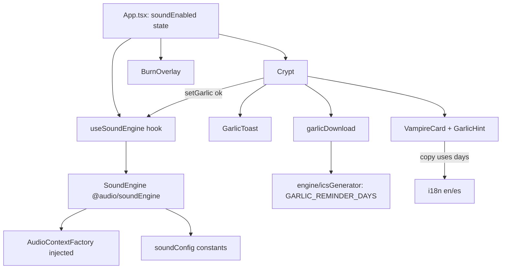

# Design Document: ux-burn-garlic-sound-fixes

## Overview

Three UX fixes for Vampire Hunter, all client-side:

1. **Burn overlay**: viewport-fixed, scroll to top on completion, reduced-motion fade.
2. **Honest garlic feedback**: a toast, a `title` tooltip and an always-visible hint, all stating that a calendar file is downloaded and that opening it in Google Calendar, Apple Calendar or Outlook adds a reminder 3 days before the next charge.
3. **Synthesized sound**: a testable Web Audio module with an injectable `AudioContext` factory. Ambience plays on every screen while sound is on, plus fire crackle on burn and a chime on garlic.

### Amendment: sound audibility bug fix

Bug: with sound on and system volume at maximum, nothing is heard on laptop or phone speakers. Verified root cause in `src/audio/soundEngine.ts` and `soundConfig.ts`:

- Ambience is two sine drones at 55 Hz and 82 Hz plus noise low-passed at 220 Hz. Small speakers cannot reproduce content below about 150 to 200 Hz.
- Effective ambience level is 0.6 (master) x 0.08 (ambience gain) x 0.3 (inner gains) = 0.0144, which is about -37 dBFS peak.
- The stake thud falls from 180 Hz to 55 Hz, with the same problem.

Fix (details in "Sound design (amended)" below): a band-passed wind at 400 to 1200 Hz swept by a sub-1 Hz LFO, a harmonic drone at 110/220/330 Hz, an ambience level raised to an effective 0.225, a crackle band-passed at 1.5 to 4 kHz, and a stake thud that starts at 300 Hz with a mid body. New Property 13 enforces that no audio-rate content sits below 100 Hz. Source code is changed only by task 10.

### Amendment 2: eerie ambience redesign

Finding from user testing: the audible ambience (constant band-passed noise plus 110/220/330 Hz sines) sounds like a laptop fan. It is a steady hum that the brain ignores, so it is not spooky. The redesign replaces it with four layers that evolve over time and never form a steady bed:

- **Pad** (main, musical layer): slow minor chords D minor, Bb, G minor, A (with an occasional tritone colour chord), detuned triangle and sine voices, overlapping crossfades.
- **Wind gusts**: noise through a high-Q resonant band-pass swept 350 to 900 Hz that howls, then drops to silence for 8 to 20 s.
- **Distant bell toll**: inharmonic partials with a long decay and a short feedback-delay reverb, every 25 to 45 s.
- **Rare details**: an owl hoot or a wood creak every 40 to 90 s.

The details are in "Ambience redesign (amendment 2)" below. The constraints from amendment 1 are kept: synthesized Web Audio only, no files, no network, sound off by default, 80 ms stop that releases every node and every timer, singleton ambience, ducking, summed peak cap 0.5, and every audio-rate frequency at 100 Hz or higher. The only constraint retired is the sub-1 Hz Wind_LFO exception, because the redesign has no LFO. Source code is changed only by task 11. I cannot measure whether it is spooky; the tests prove that it changes, stays audible and stays within budget.

### Amendment 3: loudness lift

Finding (task 11.3, Chrome): the amendment 2 ambience has an overall RMS of 0.012 and a peak of only 0.12, against a worst-case bound of 0.225. The earlier steady fan version measured RMS 0.051. The peak budgets were sized for the coherent worst case, which real signals never reach, so the sound risks being inaudible on laptop speakers. Decision: lift the overall RMS to about 0.05 or more (same Chrome, 90 s, master-output tap) without breaking the 0.5 summed-peak cap. A DynamicsCompressor or limiter is not used. Source code is changed only by task 12.

**Proposed constants (start values; task 12.2 may tune them inside the limits below).**

| Constant | Before | After | Reason |
| --- | --- | --- | --- |
| `ambienceGain` | 0.25 | 0.30 | Bus limit of 7.6. +1.6 dB. |
| `ambienceDuckedGain` | 0.12 | 0.12 | Keeps ducked + crackle 0.2 + chime 0.18 = 0.5. |
| `masterGain` | 0.9 | 0.9 | Unchanged. |
| `layerShares` | pad 0.5, wind 0.2, bell 0.2, detail 0.1 | pad 0.5, wind 0.15, bell 0.25, detail 0.1 | Sum stays 1.0. The bell is clearly audible when it rings (+25% amplitude), the wind gives up share because its gust makeup is tuned by measurement anyway. |
| `bellWet`, `bellDrySum` | 0.2, 0.75 | 0.15, 0.8 | `bellDrySum = 1 / (1 + wet / (1 - feedback)) = 1 / 1.25 = 0.8`, so the bell worst-case peak is still 1.0 of its bus. Louder dry bell, shorter reverb tail. |
| Pad voice gains | `weight / notes.length` (coherent sum 1.0) | `padCrestFactor x weight / notes.length`, `padCrestFactor` start 1.8, limit 2.0 (new constant) | Main lever. For N unrelated sines of equal amplitude a, the RMS is a x sqrt(N/2) and the coherent peak is N x a. Normalising by 1/N therefore wastes a factor of about sqrt(N) of loudness. A factor 1.8 is close to the 1/sqrt(N) normalisation for 3 to 4 notes (1.7 to 2.0). |
| `padChordPeak`, `padMaxConcurrent` | 0.5, 2 | 0.5, 2 | Unchanged, so two overlapping chords still sum to at most 1.0 of the pad envelope. |

Expected gain, as a starting estimate: bus +1.6 dB, Pad crest +5 dB, bell +2 dB, about +6.6 dB on the Pad. That is about 2.1x in amplitude and gets from 0.012 only to about 0.025. Reaching 0.05 needs another factor of about 2. The remaining levers, in order: `padCrestFactor` up to 2.0, the Pad share up to 0.6 (taken from wind and detail, shares still sum to 1.0), and `gustMakeup` for the wind. If these are not enough, task 12.2 stops at the limits, reports the measured RMS and asks the user instead of breaking the cap. I cannot promise 0.05 before the measurement.

**How the 0.5 cap is guaranteed (no limiter).** The guarantee has three parts, from strongest to weakest.

1. Deterministic, kept in the tests: the non-Pad layers keep strict shares (wind gate 1.0 x 0.15, bell 1.0 x 0.25 by `bellDrySum`, detail 1.0 x 0.1). Strict, all voices in phase, not ducked: `0.30 x (0.5 x padCrestFactor x 2 chords x 0.5 + 0.15 + 0.25 + 0.1) = 0.30 x (0.9 + 0.5) = 0.42` at `padCrestFactor` 1.8, and `0.30 x (1.0 + 0.5) = 0.45` at the limit 2.0. Both are at or below 0.5, so normal playback cannot exceed the cap even in the coherent worst case. The master output is at most `0.9 x 0.5 = 0.45`.
2. Ducked (crackle, chime or stake active): the strict Pad value would be `0.12 x (0.9 + 0.5) + 0.2 + 0.18 = 0.548`, which is over 0.5, so the strict bound cannot be kept once `padCrestFactor` is above 1.0. The ducked bound is instead the simulated peak: the sum of the actual Pad voice sinusoids (frequencies, detunes, gains and the chord envelope from `SOUND_CONFIG`) is evaluated offline in a test for two overlapping chords at their envelope peaks, and the ducked sum `0.12 x (padPeakSim + 0.5) + 0.2 + 0.18` must be at most 0.5, which means `padPeakSim` at most 1.0 of the pad share. The test uses worst-case start phases found by a grid over the voice phases, not only random ones.
3. Measured: task 12.2 reports the real master-input peak in Chrome (target at most 0.5, output at most 0.45).

Crackle and chime peaks are also coherent worst cases that never coincide with the Pad peak in practice, so the ducked check is conservative. What stays unproven: the simulation covers the Pad waveform, not the filtered wind noise, whose peak is statistical (see "Wind gust behaviour"); that is covered only by part 3.

**Test changes.** `tests/soundConfig.test.ts`: bus 0.30 (at most 0.3), shares sum 1.0 with the new values, nominal effective level 0.27 in [0.15, 0.30], Pad alone 0.135 in [0.10, 0.15], `padCrestFactor` in [1.0, 2.0], `bellDrySum x (1 + wet / (1 - feedback))` at most 1.0, ducked sum at most 0.5, strict unducked bound at most 0.5. `tests/soundEngine.test.ts` Property 8: reads the Pad voice gains from the fake context and checks their sum is `padCrestFactor` and that the layer budgets use the new shares; Property 13: bell partial peaks and the delay values; add the offline Pad worst-case simulation from part 2 as a new test. Properties 14 to 16 are not expected to change.

### Amendment 4: master limiter and second loudness lift

Finding (task 12.2, Chrome): after amendment 3 the overall RMS is 0.019 (target 0.05 or more), the peak only 0.12, and the Bell_Toll rings quieter than the Pad (bell block RMS about 0.011, Pad mean block RMS about 0.0185). The remaining levers were all blocked by caps whose only purpose is to prevent clipping without a limiter: bus at most 0.3 (7.6), Pad alone at most 0.15 (7.13), `padCrestFactor` at most about 1.27 (the bound of the offline Pad simulation), the Layer_Share and `bellDrySum` bounds, and the ducked sum 0.12 + 0.2 + 0.18. Decision (user): add a limiter on the master output, relax the per-layer budgets, and widen the Pad spectrum. This section supersedes the "How the 0.5 cap is guaranteed (no limiter)" part of amendment 3 and the sentence "A DynamicsCompressor or limiter is not used". Source code is changed only by task 13.

#### 1. Output chain and creation order

```
voices (crackle, chime, stake) -----------------------------.
Ambience_Bus (0.60, ducked 0.24) <- layer buses              v
                              '------------------------> Master_Gain (0.9) -> Limiter -> Output_Gain (0.6) -> destination
```

Nodes created in `enable()` in this fixed order, all tracked in `session.nodes` so `teardown` releases them:

| Index in `ctx.nodes` | Node | Why this position |
| --- | --- | --- |
| 0 | Master_Gain | Existing tests read `ctx.nodes[0]` as master. Unchanged. |
| 1 | Ambience_Bus | Existing tests read `ctx.nodes[1]` as the bus. It is now created in `enable()` (not in `startAmbience`) so that it keeps index 1. |
| 2 | Limiter (`createDynamicsCompressor`) | Created after the bus so the two existing indices do not move. |
| 3 | Output_Gain | Last node before the destination. |

`enable()` then wires `bus -> master -> limiter -> output -> destination`, sets the Limiter parameters with `setValueAtTime` (so the fake records them), and only after that calls `startAmbience`. Crackle, chime and stake keep connecting to `session.master`, so they are limited too. `startAmbience(s)` receives the bus that already exists instead of creating it; the ramp from 0 to `ambienceGain` over `ambienceFadeInMs` is unchanged. If any of these four creations throws (for example no `createDynamicsCompressor`), `enable()` closes the context, creates no session and the engine stays silent (Requirement 16.7): audio is never played without the limiter.

`AudioContextLike` gains one member, `createDynamicsCompressor(): DynamicsCompressorNode`. Tests locate the Limiter by `kind === 'compressor'`, not by index, and follow connections instead of assuming `master.connections` contains the destination.

`disable()` ramps both the Master_Gain and the Output_Gain to 0 over `stopRampMs` (80 ms) and, after the existing 80 ms teardown timer, `teardown` stops and disconnects every tracked node (this includes the Limiter and the Output_Gain) and closes the context. The Output_Gain is the true last stage, so silence does not depend on the compressor's internal state (its 6 ms pre-delay and release tail are fed zero by then).

#### 2. Limiter parameters and what it can and cannot do

| Parameter | Value | Allowed range (tested) | Reason |
| --- | --- | --- | --- |
| threshold | -8 dB (0.398 linear) | -12 to -6 | Above the typical Pad peaks (about 0.25 to 0.3), so only the peaks of bell strikes, gusts and overlaps are limited. |
| knee | 2 dB | 0 to 3 | A short soft knee, less audible than a hard knee. |
| ratio | 20 | 12 to 20 | The maximum the API allows is 20. Close to a limiter. |
| attack | 0.003 s | 0.001 to 0.005 | Fast. Chrome clamps the attack to at least 1 ms internally. |
| release | 0.2 s | 0.1 to 0.25 | Slow enough to avoid pumping on 150 to 400 Hz Pad notes, fast enough to recover between events. |
| Output_Gain | 0.6 | 0.4 to 1.0 | See the makeup gain below. |

**Honest limits of a `DynamicsCompressorNode`.** It is a compressor with a fast attack, not a true brickwall limiter:

- The attack is finite. A very short transient can overshoot the ceiling for the duration of the attack. Chrome has a fixed pre-delay of about 6 ms (`kPreDelay` in [dynamics_compressor.cc](https://raw.githubusercontent.com/chromium/chromium/main/third_party/blink/renderer/platform/audio/dynamics_compressor.cc)) that gives the detector a small look-ahead. Other browsers are not guaranteed to do the same, and I only measure Chrome.
- The node applies an automatic makeup gain that cannot be turned off. Reading the same file, Chrome computes `linear_post_gain = (1 / Saturate(1, k))^0.6` ("empirical/perceptual tuning"). With threshold -8 dB and ratio 20 a full-scale input comes out of the static curve at about -7.6 dB (0.417), so the makeup is about `(1 / 0.417)^0.6 = 1.69` (+4.6 dB). This applies to all signal, also below the threshold. This number is my estimate from the source, not a measured value, and the knee shifts it slightly.
- It is not a safety net against full scale on its own: a stack of unusually coherent peaks could still pass for a few milliseconds.

**Exact chain and headroom.** Estimated steady-state ceiling at the Limiter input of 0 dB: `0.417 x 1.69 = 0.705` at the Limiter output, times Output_Gain 0.6 gives 0.423. At +6 dB input it is about 0.437 (the ratio 20 lets the output rise only 0.3 dB for 6 dB more input). The documented headroom to the 0.5 target is therefore about 1.2 to 1.5 dB, which is the overshoot the finite attack may add before the contract is broken. For small signals, the makeup (+4.6 dB) and the Output_Gain 0.6 (-4.4 dB) cancel, so the Output_Gain does not change the RMS budget below (net +0.2 dB). The example in the request was an Output_Gain of 0.9; because of the makeup that would let the ceiling reach about 0.63, so I propose 0.6 as the start value and 13.3 tunes it by measurement.

**The contract (Requirement 16.5).** Measured output peak at most 0.5 over at least 60 s of Ambience and over the burst scenario, with 10 percent tolerance for isolated transient samples (0.55), the count of samples above 0.5 reported, and a failure otherwise. This is a measurement contract with documented headroom, not a mathematical guarantee.

**What the tests can and cannot prove.** Unit tests (with a fake context that has no signal processing) can assert: the compressor node exists once per session, its five parameters equal the `SOUND_CONFIG` values and lie in the allowed ranges, the Output_Gain is at most 1.0, the chain master, Limiter, Output_Gain, destination is the only path to the destination, the creation order, ramp to 0 within 80 ms on disable, release of the Limiter, fresh Limiter after re-enable, and silence when the compressor cannot be created. They cannot prove the peak ceiling, the makeup gain, the RMS, pumping or the bell-to-pad ratio. Those are verified only in Chrome in task 13.3.

#### 3. Relaxed per-layer budgets: what is removed and what replaces it

| Removed (deterministic gate) | Replaced by |
| --- | --- |
| `maxSummedPeak` 0.5, `allowedPeak(s, desired)`, `othersPeak`, summed-peak assertions (10.2, Property 8) | Hard maxima per value (below), plus the Limiter. Stake, crackle and chime each play at their own peak (0.3, 0.2, 0.18). |
| Ducked sum 0.12 + 0.2 + 0.18 = 0.50, strict unducked bound, 7.18 worst-case layer sums | Ducking is kept for clarity: 0.60 to 0.24 (ratio 0.4, ducked at most 0.5 x normal). It is no longer an anti-clipping mechanism. |
| `padCrestFactor` at most 2.0 and the offline Pad worst-case simulation test | `padCrestFactor` at most 3.0 (chosen 2.8, near the square root of 9 voices, 3.0). No simulation test. |
| `bellDrySum` at most `1 / (1 + wet / (1 - feedback))` | `bellDrySum` at most 2.0 (chosen 1.8). The feedback stays at most 0.5, so the tail still decays. |
| Layer_Shares sum to 1.0, effective level 0.15 to 0.30, Pad alone 0.10 to 0.15 | Each share at most 1.0; Pad alone (master x bus x pad share) between 0.15 and 0.40. |

The voices map in the engine stays, because the ducking needs to know whether any other voice is active, but it no longer carries peaks that feed a cap. The `voices` entry can become a plain `Set<number>` or keep its `Map` value for minimal diff; the choice is left to task 13.1.

**Hard maxima asserted by tests.**

| Value | Chosen | Hard maximum | Minimum (audible) |
| --- | --- | --- | --- |
| `masterGain` | 0.9 | 1.0 | |
| `ambienceGain` | 0.60 | 1.0 | 0.4 |
| `ambienceDuckedGain` | 0.24 | 0.5 x `ambienceGain` | |
| Layer_Share each | pad 0.5, wind 0.12, bell 0.7, detail 0.08 | 1.0 | |
| Pad alone = master x bus x pad share | 0.27 | 0.40 | 0.15 |
| `padCrestFactor` | 2.8 | 3.0 | 1.0 |
| `bellDrySum` | 1.8 | 2.0 | |
| `bellFeedback` | 0.4 | 0.5 (kept) | |
| `crackleGain` / `chimeGain` / `stakeGain` | 0.2 / 0.18 / 0.3 | unchanged | |
| `limiterOutputGain` | 0.6 | 1.0 | 0.4 |

#### 4. Gain-staging budget (estimate, verified in 13.3)

Previous measurements (amendment 3, Chrome, 90 s, master tap): overall RMS 0.019, Pad mean block RMS 0.0185, bell block RMS 0.011, peak 0.12.

For sines of amplitude `a_i = crest x w_i / W` with `W = sum of w_i`, the RMS is `crest x sqrt(sum(w_i^2) / 2) / W`. Before: 4 notes with sine 0.6 and triangle 0.4 (weights, `W = 4`, `sum(w^2) = 2.08`), crest 1.25, so RMS unit `1.25 x sqrt(1.04) / 4 = 0.319`. After: the same 4 notes plus 2 upper sines of weight 0.45 each (`W = 4.9`, `sum(w^2) = 2.485`), crest 2.8, so RMS unit `2.8 x sqrt(1.2425) / 4.9 = 0.637`. The ratio is 2.0 (+6.0 dB). The request estimated +6 dB for crest alone; adding the upper voices dilutes each voice a little, and the net is the same +6 dB.

| Stage | Before (amendment 3) | After | Change |
| --- | --- | --- | --- |
| Ambience_Bus | 0.30 | 0.60 | +6.0 dB |
| Pad share | 0.55 | 0.50 | -0.8 dB |
| Pad RMS unit (crest and voices, above) | 0.319 | 0.637 | +6.0 dB |
| Pad lowpass | 1200 Hz | 2500 Hz | about 0 dB on RMS (adds upper-voice and triangle harmonic energy; the spectrum moves up) |
| Limiter makeup (estimate 1.69) and Output_Gain 0.6 | none | +4.6 dB and -4.4 dB | +0.2 dB |
| Limiter gain reduction on peaks | none | 0 to about -1.5 dB (estimate) | 0 to -1.5 dB |
| **Pad total** | RMS 0.0185 | **+11.4 dB gross, +9.9 to +11.4 dB after limiting, about x3.1 to x3.7** | about 0.058 to 0.068 |
| **Overall RMS** (pad dominates) | 0.019 | | **about 0.057 to 0.068 against the target 0.05**, margin +1.2 to +2.7 dB |

Bell: the bell block RMS scales with `bus x share x bellDrySum`. Before `0.30 x 0.25 x 0.8 = 0.06`; after `0.60 x 0.7 x 1.8 = 0.756`, a factor 12.6 (+22 dB) on 0.011, about 0.139. Pad mean block RMS after is about 0.0185 x 3.6 = 0.067, so the ratio before limiting is about 2.1. A bell strike peaks near `0.4 x 1.8 x 0.7 x 0.6 x 0.9 x (1 / 0.4) = 0.68` coherent (before echoes), above the threshold of 0.398, so the Limiter reduces the strike by a few dB for the first hundreds of milliseconds, which also lowers the bell block RMS. Estimated ratio after limiting: 1.5 to 1.9 against the target of at least 1.5. This is the least certain number; the levers are the bell share (to 1.0) and `bellDrySum` (to 2.0).

The wind and the details also gain +6 dB through the bus (the wind `gustMakeup` stays 20 at share 0.12). The wind peak, which used to be near the old caps, is now handled by the Limiter; 13.3 reports whether the wind became too prominent and may lower `gustMakeup` (not raise it).

**Tuning order in 13.3 (stop as soon as all targets hold).**

1. RMS below 0.05: `padCrestFactor` up to 3.0, then `ambienceGain` up to 0.8, then the Pad share up to 0.7.
2. Bell below 1.5 times the Pad: bell share up to 1.0, then `bellDrySum` up to 2.0. If the `reduction` readout shows the Limiter holding strikes back by many dB, raising the threshold toward -6 dB is a last resort, with the output peak re-checked.
3. Output peak above 0.5 (above 0.55, or sustained above 0.5): `limiterOutputGain` down to 0.4, then threshold down to -12 dB, then lower the bus. Any retuning that lowers the output gain must be checked against the RMS target.
4. If a target is still missed at a limit, stop and report the measured values to the user instead of exceeding a hard maximum.

#### 5. Pad spectrum: lowpass 2500 Hz and upper voices

`padLowpassHz` 2500 (was 1200). Each chord adds two soft sine Pad_Upper_Voices from a new `chordUpper` table; the existing `chordSet` keeps the four body notes unchanged. All frequencies are at least 100 Hz and in the 415 to 880 Hz range requested.

| Chord | Body notes (unchanged) | Upper voices (new) |
| --- | --- | --- |
| Dm | 146.83, 174.61, 220.00, 293.66 | 587.33 (D5), 880.00 (A5) |
| Bb | 116.54, 146.83, 174.61, 233.08 | 466.16 (Bb4), 698.46 (F5) |
| Gm | 196.00, 233.08, 293.66, 392.00 | 587.33 (D5), 783.99 (G5) |
| A | 110.00, 164.81, 220.00, 277.18 | 659.25 (E5), 880.00 (A5) |
| tri | 146.83, 174.61, 207.65, 261.63 | 415.30 (Ab4), 523.25 (C5) |

The request suggested one upper voice of about 0.35 weight. With one voice at 0.35 the voice energy share is `0.1225 / (2.08 + 0.1225) = 5.6%`, which hardly moves the spectrum. Two voices at 0.45 give `0.405 / 2.485 = 16.3%` of the voice energy in 415 to 880 Hz, plus the lift of the harmonics through the higher cutoff. I propose the two-voice version and report the measured shares; the weight is a single constant (`padUpperWeight`) that 13.3 can change.

`padLayer.ts` changes: the lowpass cutoff comes from `padLowpassHz`; for each chord it creates, besides the sine and triangle pair of each body note, one sine per upper voice with detune `-c` (c drawn from `padDetuneCents`, so at most 8 cents), gain `padCrestFactor x padUpperWeight / W`; and body voices use `padCrestFactor x weight / W`, where `W = notes.length + padUpperWeight x uppers.length` (the coherent sum of all voice gains is still `padCrestFactor`). The chord envelope, timing, overlap and crossfade code are unchanged, as are the 6 to 10 s envelope and the peak of 0.5. The number of oscillators per chord goes from 8 to 10 and at most 20 can sound at once; this is cheap for Web Audio.

The spectrum shares above 100 Hz, 150 Hz and 300 Hz are reported in 13.3, not asserted. Honest expectation: the body notes sit at 110 to 392 Hz, so the share above 300 Hz stays modest (mostly the upper voices, Gm's 392 Hz and the harmonics of the triangle voices); the share is reported so the user can judge.

#### 6. SOUND_CONFIG after amendment 4

```ts
masterGain: 0.9,
ambienceGain: 0.6,              // hard max 1.0
ambienceDuckedGain: 0.24,       // < ambienceGain, <= 0.5 x ambienceGain
// maxSummedPeak removed; replaced by:
outputPeakTarget: 0.5,          // measured contract at the Output_Gain output (Req 16.5)
outputPeakTolerance: 1.1,       // isolated transient samples up to 0.55
limiter: { thresholdDb: -8, kneeDb: 2, ratio: 20, attackSec: 0.003, releaseSec: 0.2 },
limiterOutputGain: 0.6,         // hard max 1.0; derived from Chrome's makeup gain, tuned in 13.3
layerShares: { pad: 0.5, wind: 0.12, bell: 0.7, detail: 0.08 },   // each <= 1.0, no sum rule
padCrestFactor: 2.8,            // hard max 3.0
padLowpassHz: 2500,
chordUpper: { Dm: [587.33, 880.0], Bb: [466.16, 698.46], Gm: [587.33, 783.99], A: [659.25, 880.0], tri: [415.3, 523.25] },
padUpperWeight: 0.45,           // relative to 1.0 for one body note
bellDrySum: 1.8,                // hard max 2.0
```

Everything else (chords, timing, gusts, bell timing and ratios, wet 0.15, feedback 0.4, details, crackle 0.2, chime 0.18, stake 0.3, fade-in, stop ramp) is unchanged.

#### 7. Requirement criteria that change

| Criterion | Change |
| --- | --- |
| 7.6 | Bus normal value 0.30 to 0.60; the limit 0.3 becomes a hard maximum 1.0. |
| 7.8 | The stop ramp covers the Master_Gain and the Output_Gain; the Limiter is released. |
| 7.12, 15.5 | Two Pad_Upper_Voices per chord, Chord_Set extended, lowpass 2500 Hz. |
| 7.13 | Windows and caps replaced by the Gain_Staging_Budget and the hard maxima; the RMS, bell and peak figures are verification targets. |
| 7.15 | Bell louder (share 0.7, `bellDrySum` 1.8); the 0.8 bound removed. |
| 7.18 | Per-layer worst-case sums removed; hard maxima kept. |
| 10.1, 10.2, 10.3, 10.5 | Chain through the Limiter; sum rule and `allowedPeak` removed; ducking kept (0.24); new config list. |
| 12.5, 12.11, 12.14, 12.15 | Test requirements follow the new limits; simulation and summed-peak tests removed; limiter tests added. |
| 13.10, 13.11 | New targets and the burst scenario. |
| 16 (new) | Limiter requirement, with the honest contract. |

Superseded-limits rows for all of these are in the requirements document.


### Verified facts about the current code

- `src/engine/icsGenerator.ts` builds an all-day event with `DTSTART;VALUE=DATE` equal to `nextBiteDate` minus **3 days** (`isoMinusDaysToIcsDate(vampire.nextBiteDate, 3)`). It has no `VALARM`. The existing test `tests/icsGenerator.test.ts` already asserts the 3-day offset. So "3 days before" is correct and "the day before" is wrong.
- `en.json` `garlic.downloadSuccess` currently says "Reminder added to your calendar." That is untrue (the file is only downloaded). It is replaced.
- `BurnOverlay` is positioned `absolute` inside `<main>` and is rendered only when `view === 'results'`.
- `sound.ts` lives in `src/components/`, uses a module-level lazy `AudioContext`, and only has `playStakeThud`. It is called from `Crypt.tsx` with a `soundEnabled` prop. `soundEnabled` state lives in `App.tsx` (default `false`, not persisted).

### Key decisions

| Decision | Rationale |
| --- | --- |
| Offset constant `GARLIC_REMINDER_DAYS = 3` exported from `src/engine/icsGenerator.ts`, used by the generator and passed to copy as `{{days}}` | Copy and file can never drift apart (Req 4.2b). The engine stays pure. |
| New folder `src/audio/` with alias `@audio`; `sound.ts` is moved out of `components/` | `engine/` is reserved for pure detection logic (no UI, no browser APIs). `components/` is for React components, one per file. Audio is neither. `smart_relocate` updates the import in `Crypt.tsx`. |
| `SoundEngine` is a class created with `createSoundEngine(factory)` | Injectable `AudioContext` factory allows Vitest with a fake context. No module-level singletons in the logic. |
| One engine instance owned by `App` via a `useSoundEngine` hook | Ambience is tied to the toggle, not to any screen, so it plays on every screen without restarts (Req 7). |
| (amendment 2) Ambience logic moves to `src/audio/ambience.ts`, behind a small `AmbienceHost` interface | `soundEngine.ts` is already long (about 600 lines). Four layers plus scheduling would double it. The host passes the context, the bus, the injected random, tracked timers and tracked node groups, so the ambience reuses the engine release path and cannot leak nodes or timers. |
| (amendment 2) Events are scheduled with tracked `setTimeout` timers, not with `AudioContext` look-ahead | Tests use fake timers and an injected random. Timers are cleared on disable, which keeps the "all timers released" guarantee of Property 6. |
| Ambience is not started by screens | Screens only call `playStake()`, `startCrackle()`, `playChime()` through context, so none of them can stack or stop the ambience. |

## Architecture



### File layout

```
src/
  audio/
    soundConfig.ts        volume + timing constants (single source, Req 10.4)
    soundEngine.ts        createSoundEngine(factory): SoundEngine  (no React)
    audioContextFactory.ts defaultAudioContextFactory() (window.AudioContext | webkitAudioContext)
    index.ts
  engine/
    icsGenerator.ts       + export const GARLIC_REMINDER_DAYS = 3
    cryptStorage.ts       + optional soundEnabled field
  components/
    GarlicToast.tsx / .module.css       new, one component
    GarlicHint.tsx / .module.css        new, one component
    useSoundEngine.ts                   new hook (React glue only)
    VampireCard.tsx                     adds title + hint + aria-describedby
    BurnOverlay.tsx / .module.css       position: fixed
    Crypt.tsx                           toast state, calls engine
    App.tsx                             owns engine, burn lifecycle, scroll to top
    sound.ts                            DELETED (moved to src/audio)
tests/
  soundEngine.test.ts, soundConfig.test.ts, garlicCopy.test.tsx,
  icsOffset.test.ts, burnOverlay.test.tsx, garlicToast.test.tsx
```

`vite.config.ts` and `tsconfig` gain the alias `@audio` -> `src/audio`, matching the existing `@engine`, `@data`, `@i18n` entries. `stakeThud` moves into `soundEngine.ts` as `playStake()`.

## Components and Interfaces

### `src/audio/soundConfig.ts`

```ts
export const SOUND_CONFIG = {
  masterGain: 0.9,            // Req 10.1 (<= 1.0), was 0.6
  ambienceGain: 0.25,         // Req 7.6 (<= 0.3 at master input), was 0.08
  ambienceDuckedGain: 0.12,   // Req 10.2, used while crackle, chime or stake play, was 0.04
  ambienceFadeInMs: 800,      // Req 7.7 (>= 500)
  crackleGain: 0.2,           // Req 8.5 (<= 0.2), was 0.25
  crackleReducedFactor: 0.5,  // Req 8.6
  crackleFadeOutMs: 300,      // Req 8.2 (<= 400)
  chimeGain: 0.18,            // Req 9.4 (<= 0.18), was 0.2
  chimeMaxMs: 1500,           // Req 9.3
  stakeGain: 0.3,             // Req 10.3 (<= 0.3)
  stopRampMs: 80,             // Req 6.4 / 7.8 (<= 100)
  maxSummedPeak: 0.5,         // Req 10.2
  // New (amended), all in Hz unless noted
  ambienceWindShare: 0.5,     // inner gain of the wind branch
  ambienceDroneShares: [0.25, 0.15, 0.10], // inner gains for 110/220/330 Hz, sum with wind = 1.0
  droneFrequencies: [110, 220, 330],
  droneDetuneCents: [-5, 6, -4],           // Req 7.12 (|cents| <= 10)
  windCenterHz: 800,          // Req 7.11: band-pass centre
  windSweepHz: 300,           // LFO depth: centre sweeps 500..1100 (inside 400..1200)
  windQ: 1.2,
  windLfoHz: 0.12,            // Req 15.4 (<= 1)
  crackleBandMinHz: 1500,     // Req 8.8
  crackleBandMaxHz: 4000,
  stakeStartHz: 300,          // Req 10.6
  stakeEndHz: 120,
  stakeBodyHz: 700,
  stakeShares: { low: 0.5, body: 0.3, crack: 0.2 }, // sum 1.0
  minAudioHz: 100,            // Req 15.1/15.2, asserted by tests
} as const;
```

**Level budget (amended; the inner-gain split below is superseded by the Layer_Shares of amendment 2, the totals are unchanged).** Normal Ambience peak at the master input is `ambienceGain x (wind 0.5 + drone 0.5) = 0.25`, under the 0.3 bus limit. After master gain the effective level is `0.9 x 0.25 x 1.0 = 0.225`, inside the required 0.15 to 0.25. This is a worst-case peak bound, not RMS. Real RMS of noise plus three sines is lower, so I propose verifying actual RMS in task 10.3 instead of assuming it.

**Summed peak at the master input (cap 0.5, unchanged).**

| Combination | Calculation | Sum |
| --- | --- | --- |
| Ambience alone | 0.25 | 0.25 |
| Ducked ambience + crackle + chime | 0.12 + 0.20 + 0.18 | 0.50 |
| Ducked ambience + stake alone | 0.12 + 0.30 | 0.42 |
| Ducked ambience + stake + chime | 0.12 + 0.30 + 0.18 = 0.60, so `playStake` scales to 0.20 | 0.50 |
| Ducked ambience + stake + crackle | 0.12 + 0.30 + 0.20 = 0.62, so stake scales to 0.18 | 0.50 |

The existing `allowedPeak` logic (cap minus ducked ambience minus other active peaks) is kept unchanged, so ordering stays safe. With the sum at most 0.5 at the master input and master 0.9, the output peak is at most 0.45, so there is no clipping and no `DynamicsCompressor` is needed. A compressor is rejected: it adds a node, pumping on the quiet ambience, and a testing burden, with no benefit while the cap holds.

**Ducking audibility.** Ducked ambience is 0.12, so about 0.108 after master. It remains audible under crackle, instead of vanishing at 0.04.

### `src/audio/soundEngine.ts`

```ts
export interface AudioContextLike {           // minimal structural subset, easy to fake
  readonly state: 'suspended' | 'running' | 'closed';
  readonly currentTime: number;
  readonly sampleRate: number;
  readonly destination: AudioNode;
  resume(): Promise<void>;
  suspend(): Promise<void>;
  close(): Promise<void>;
  createGain(): GainNode;
  createOscillator(): OscillatorNode;
  createBuffer(ch: number, len: number, rate: number): AudioBuffer;
  createBufferSource(): AudioBufferSourceNode;
  createBiquadFilter(): BiquadFilterNode;
  createDelay(maxDelayTime?: number): DelayNode;   // (amendment 2) bell reverb
  createDynamicsCompressor(): DynamicsCompressorNode;   // (amendment 4) master Limiter
}

/** Returns a context, or null when Web Audio is unsupported. May throw; the engine catches. */
export type AudioContextFactory = () => AudioContextLike | null;

export interface SoundEngineDeps {
  factory: AudioContextFactory;
  setTimeout?: typeof setTimeout;     // injectable for fake timers
  clearTimeout?: typeof clearTimeout;
  random?: () => number;              // injectable for deterministic crackle
}

export interface SoundEngine {
  /** Call inside the user gesture. Creates/resumes context, starts ambience once. */
  enable(): void;
  /** Ramps master to 0 within stopRampMs, stops and disconnects every node, clears timers. */
  disable(): void;
  isEnabled(): boolean;
  playStake(): void;
  startCrackle(opts: { reducedMotion: boolean }): void;
  stopCrackle(): void;
  playChime(): void;
  /** Called on document visibilitychange. */
  setDocumentHidden(hidden: boolean): void;
}

export function createSoundEngine(deps: SoundEngineDeps): SoundEngine;
```

Behavior rules:

- Before `enable()` the factory is never called (Req 6.3). While disabled every `play*`/`start*` is a no-op that creates no nodes (Req 6.2, 9.6, 8.7).
- `enable()` is idempotent: it creates the context lazily, calls `resume()` synchronously in the gesture (Req 6.7), builds `master -> destination` with `master.gain = SOUND_CONFIG.masterGain`, and starts the ambience only if it is not already running (Req 7.4). The ambience (see "Sound design (amended)") is a wind branch plus a harmonic drone branch, through an `ambience` gain that ramps from 0 to `ambienceGain` over `ambienceFadeInMs`.
- (amendment 4) `enable()` creates master (`ctx.nodes[0]`), the Ambience_Bus (`ctx.nodes[1]`), the Limiter and the Output_Gain in that order, wires `bus -> master -> limiter -> output -> destination`, and only then starts the Ambience. If any of these creations throws, no session is created and the engine stays silent. `disable()` ramps the Master_Gain and the Output_Gain to 0 within 80 ms and `teardown` releases the Limiter with every other node. `allowedPeak` and the summed-peak cap are removed; ducking stays. See "Amendment 4".
- `startCrackle` is idempotent. It schedules randomized noise bursts (band-pass filtered, centre randomized in 1500 to 4000 Hz, 20 to 120 ms apart via `random`) through a `crackle` gain with peak `crackleGain` (times `crackleReducedFactor` when `reducedMotion`). Pending timers are tracked in a `Set`. `stopCrackle` fades out over `crackleFadeOutMs` and clears the timers.
- `playChime` plays two sine partials (880 Hz and 1320 Hz) with `exponentialRampToValueAtTime` decay, stopped at or before `chimeMaxMs`.
- `disable()` ramps master to 0 over `stopRampMs`, then (via tracked timer) stops and disconnects all tracked sources, clears all timers, and closes the context. A new `enable()` creates a fresh context. All created nodes are tracked in one registry so release is complete (Req 6.5).
- `setDocumentHidden(true)` calls `suspend()`; `false` calls `resume()` only if enabled (Req 7.9, 7.10).
- Every method is wrapped in try/catch; factory returning `null` or throwing leaves the engine permanently silent and the UI working, with no error shown (Req 6.8).

### Sound design (amended)

All nodes are created in `startAmbience`, `playStake` and `playBurst` in `src/audio/soundEngine.ts` and tracked in the existing registries so `disable()` still releases everything.

**Ambience graph (superseded by amendment 2, kept for history; see "Ambience redesign (amendment 2)").** `bus` = the ambience gain, created first after master so `bus.connect(master)`:

```
wind:   looping noise (2 s buffer) -> bandpass(center 800, Q 1.2) -> windGain(0.5) -> bus
LFO:    oscillator(0.12 Hz, sine) -> lfoGain(300) -> bandpass.frequency      (not connected to bus)
drone:  osc 110 Hz (-5c) -> g(0.25) -> bus
        osc 220 Hz (+6c) -> g(0.15) -> bus
        osc 330 Hz (-4c) -> g(0.10) -> bus
```

The band-pass centre stays in 500 to 1100 Hz, inside the 400 to 1200 Hz requirement. The LFO is the only oscillator at or below 1 Hz and is the only one not connected to the master path. Drone oscillators are sines. A sine at 110 Hz is still weak on a phone, so the 220 and 330 Hz partials carry the audible energy and the noise carries the rest. Nothing relies on content under 100 Hz.

**Stake thud:**

```
low:   sine 300 -> 120 Hz (exp ramp, 0.18 s), gain peak*0.5, decay 0.3 s
body:  triangle 700 Hz, gain peak*0.3, attack 5 ms, decay 0.12 s
crack: noise (60 ms) -> bandpass(2000, Q 0.8) -> gain peak*0.2, decay 0.08 s
```

The three shares sum to 1.0, so the voice peak stays at `peak <= 0.3`.

**Crackle burst:** `bandpass` instead of `highpass`, `frequency = 1500 + random()*2500`, `Q = 0.8`. A band-pass keeps the crackle energy in the 1.5 to 4 kHz range where small speakers respond well, and drops the harsh top end. The chime is unchanged (880 Hz and 1320 Hz).

**Unchanged:** 80 ms stop ramp, off by default, no audio files, no network, singleton ambience, ducking and full release on disable.

**What I cannot guarantee.** Speaker response varies by device and I cannot measure a physical laptop or phone from here. The level numbers above are gain-staging bounds, and the frequency choices follow the stated assumption that small speakers are weak below about 150 Hz. Task 10.3 checks the graph and measures RMS in a browser, which shows the signal exists and is not tiny, but does not prove loudness on real hardware.

### Ambience redesign (amendment 2)

#### File split

```
src/audio/
  soundConfig.ts     + ambience constants (below); drone/wind-LFO constants removed
  soundEngine.ts     crackle, stake, chime, ducking, session, release; calls startAmbience(host)
  ambience.ts        NEW  startAmbience(host): builds the layer buses and the four schedulers
  index.ts           unchanged exports
```

`ambience.ts` has no React imports. It talks to the engine only through:

```ts
export interface AmbienceHost {
  ctx: AudioContextLike;
  bus: GainNode;                       // the ambience bus, already connected to master
  random: () => number;                // injected
  schedule(fn: () => void, ms: number): void;   // tracked setTimeout; cleared on disable
  track(node: AudioNode, source?: boolean): void;  // long-lived node, released on teardown
  openGroup(): { track(node: AudioNode, source?: boolean): void; release(): void };
  // in-flight node group (a chord, a gust ramp, a bell, a detail), also released on teardown
  isHidden(): boolean;                 // true after setDocumentHidden(true)
}
export function startAmbience(host: AmbienceHost): void;
```

The engine creates the master (`ctx.nodes[0]`) and the ambience bus (`ctx.nodes[1]`) in that order, as today, then calls `startAmbience`. In-flight groups go in the same `groups` set that `teardown` already releases, and their release timers go through `schedule`, so `disable()` clears them.

#### Graph

```
bus (0.25, ducked 0.12)
 |- padBus   (0.5)  <- padFilter (lowpass 1200 Hz, Q 0.5) <- chordGain[k] <- voices (sine +c / triangle -c)
 |- windBus  (0.2)  <- gate (gain, ~0 between gusts) <- makeup <- bandpass (Q 8..14, 350..900 Hz) <- loop noise (1 source)
 |- bellBus  (0.2)  <- bellIn <- partial oscillators (5) x env gain
 |                     bellIn -> delay (0.16 s) -> wet (0.2) -> bellBus
 |                                delay -> feedback (0.4) -> delay
 '- detailBus (0.1) <- owl: 2 sine oscillators x env gain   |   creak: noise burst -> bandpass -> env gain
```

Long-lived nodes (tracked at start): the layer buses, `padFilter`, the wind noise source, band-pass, makeup and gate, `bellIn`, the delay, wet and feedback gains. Per-event nodes (tracked in groups and released after the event): chord voices and `chordGain`, bell partials, detail oscillators and noise.

#### Constants added to `SOUND_CONFIG`

```ts
// Removed: ambienceWindShare, ambienceDroneShares, droneFrequencies, droneDetuneCents,
//          windCenterHz, windSweepHz, windQ, windLfoHz
layerShares: { pad: 0.5, wind: 0.2, bell: 0.2, detail: 0.1 },   // sum 1.0
chordSet: {                                   // Hz, every value >= 100 (inversions/upper voicings)
  Dm:  [146.83, 174.61, 220.0, 293.66],       // D3 F3 A3 D4
  Bb:  [116.54, 146.83, 174.61, 233.08],      // Bb2 D3 F3 Bb3
  Gm:  [196.0, 233.08, 293.66, 392.0],        // G3 Bb3 D4 G4
  A:   [110.0, 164.81, 220.0, 277.18],        // A2 E3 A3 C#4
  tri: [146.83, 174.61, 207.65, 261.63],      // D F Ab C, the tritone colour (half-diminished)
},
progression: ['Dm', 'Bb', 'Gm', 'A'],
tritoneChance: 0.12,                          // never in two consecutive slots
padDetuneCents: [3, 8],                       // |cents| <= 10; sine +c, triangle -c
padChordSec: [6, 10],                         // envelope length of one chord
padStartFraction: 0.5,                        // next chord starts at >= 0.5 x current length
padMaxConcurrent: 2,
padChordPeak: 0.5,                            // envelope peak; 2 x 0.5 = 1.0 of the pad share
padLowpassHz: 1200,
gustGapSec: [8, 20],
gustRiseSec: [2, 3.5], gustFallSec: [2.5, 4],  // total <= 7.5 s < 8 s, so one gust at a time
gustSweepHz: [350, 900, 400],                 // start, peak, end of the centre sweep
gustQ: [8, 14],
gustPeak: [0.6, 1.0],                         // gate gain peak, times the 0.2 wind share
gustMakeup: 6,                                // makeup before the gate, tuned in task 11.3
windFloorGain: 0.0001,                        // gate gain between gusts (<= 0.02 required)
bellGapSec: [25, 45],
bellBaseHz: [220, 330],
bellRatios: [1, 2.0, 2.76, 5.4, 8.9],
bellShares: [0.4, 0.25, 0.18, 0.1, 0.07],     // sum 1.0, scaled by bellDrySum
bellDecaySec: [4, 6],                         // base partial; partial i decays bellDecayScale[i] x
bellDecayScale: [1, 0.8, 0.6, 0.45, 0.3],
bellDelaySec: 0.16,                           // within 0.12..0.2
bellFeedback: 0.4,                            // <= 0.5
bellWet: 0.2,
bellDrySum: 0.75,                             // = 1 / (1 + wet / (1 - feedback)) = 1 / 1.333
detailGapSec: [40, 90],
owlNotesHz: [[420, 350], [380, 310]],
creakGlideHz: [160, 260],
creakQ: 5,
```

#### Pad behaviour

1. At `enable()` the first chord starts immediately and a pad timer is set for the next one. Later each timer fire does: pick the next chord, build it, schedule the next timer.
2. **Chord choice.** Slot `i` normally plays `progression[i % 4]`. With probability `tritoneChance` (drawn from the injected random, and only if the previous slot was not a tritone) the slot plays `tri` instead. The progression index advances either way, so the tritone is a colour, not a loop reset. Any two consecutive slots therefore differ, and in a simulated 120 s at least 3 distinct chords sound (4 when the random never selects the tritone).
3. **Voices.** Each of the 4 notes gets two oscillators: a sine at `+c` cents and a triangle at `-c` cents, with `c` drawn from `padDetuneCents` (`|c| <= 8`). Frequencies are set to the exact table value; detune uses `osc.detune`. Voice gains inside a chord sum to 1.0 (sine weighted higher than triangle). All voices of a chord feed one `chordGain`.
4. **Envelope.** The length `D` is drawn from `padChordSec`. `chordGain.gain.value` starts at 0 (a plain property assignment, so the only automation event on that param is the curve), then `setValueCurveAtTime(raisedCosine(64 points) x padChordPeak, start, D)` gives a slow rise and fall. Oscillators stop at `start + D + 0.1 s`; a release timer disconnects the group at `D + 0.5 s`.
5. **Overlap and cap.** The next chord starts after `max(padStartFraction x D, end of the chord before - now)` seconds. Because a chord never starts before the chord two slots back has ended, at most `padMaxConcurrent = 2` chords sound at once, and consecutive chords always overlap, because the gap is at most 5 s (the second term is at most half of the previous length, which is at most 5 s) and every chord lasts at least 6 s, so the crossfade is real. The chord gap is therefore between 3 and 5 s. The worst-case pad peak is `2 x 0.5 = 1.0` of the pad bus, which is 0.5 of the ambience bus.
6. **Why this is musical and not a drone.** The chord changes every 3 to 5 s with 6 to 10 s envelopes, the voices are detuned a few cents (slow beating), the progression is minor, and the tritone chord adds tension. The lowpass at 1200 Hz keeps the triangle voices soft.

#### Wind gust behaviour

- One looping noise source (2 s buffer, built with the injected random) runs from `enable()`, through one band-pass and a makeup gain into `gate`. `gate.gain` is `windFloorGain` (0.0001) between gusts, so the noise bed is inaudible. This keeps exactly one looping buffer source.
- A gust timer fires every `gustGapSec` seconds. A gust draws `Q` in `gustQ`, a rise time and a fall time, and a peak in `gustPeak`. Automation: `bp.Q` set; `bp.frequency` set 350, linear ramp to 900 at the peak, exponential ramp to 400 at the end; `gate.gain` set to the floor, `exponentialRamp` to the peak, `exponentialRamp` back to the floor. All centre values are in 350 to 900 Hz.
- The gust length (rise + fall at most 7.5 s) is shorter than the minimum gap (8 s), so gusts never overlap and the gate has returned to the floor before the next gust starts.
- A narrow band-pass removes most noise energy (Q 10 at 600 Hz passes about 60 Hz of bandwidth), so the RMS is much lower than the peak budget. `gustMakeup` compensates. The makeup is outside the budget table (the budget is counted at the gate), so its value is tuned and verified in task 11.3 against the measured master peak and the 0.5 cap. This is a statistical bound for filtered noise, not a hard limit, and it is reported honestly.

#### Bell behaviour

- A bell timer fires every `bellGapSec`. A base frequency is drawn from `bellBaseHz` (220 to 330 Hz). Five sine partials are built at `base x bellRatios[i]` (all >= 220 Hz). Partial gain `peak_i = bellShares[i] x bellDrySum` (soft 15 ms attack, then `exponentialRampToValueAtTime(0.0001, t + decay_i)`, where `decay_0` is in `bellDecaySec` and `decay_i = decay_0 x bellDecayScale[i]`).
- Reverb: `bellIn -> bellBus` (dry) and `bellIn -> delay(0.16 s) -> wet(0.2) -> bellBus` with `delay -> feedback(0.4) -> delay`. The delay network is created once at `enable()` and tracked as long-lived nodes, so `disable()` releases it. It decays on its own because the feedback is below 1.
- **Bound.** The geometric sum of echoes is `1 + wet / (1 - feedback) = 1.333`. With `bellDrySum = 0.75` the worst-case bell peak is `0.75 x 1.333 = 1.0` of the bell bus, which is 0.2 of the ambience bus.
- Partial oscillators stop after `decay_i + 0.2 s`; the group is released after the longest decay plus 0.5 s.

#### Rare details

A detail timer fires every `detailGapSec`. With the injected random, `< 0.5` plays an owl hoot, otherwise a wood creak.
- **Owl:** two sine notes. Note 1 sets 420 Hz and exponential-ramps to 350 Hz over 0.5 s, note 2 starts 0.7 s later and falls 380 to 310 Hz. Each has an 80 ms attack and an exponential decay of about 0.5 s, peak 1.0 of the detail bus.
- **Creak:** a 0.5 s noise buffer, band-pass Q 5 whose centre glides linearly 160 to 260 Hz, envelope with a slow attack and a fast decay.
- The detail bus has gain 0.1 and only one detail runs at a time (the gap is at least 40 s and a detail lasts less than 2 s).

#### Scheduling, hidden document and singleton

- `schedule` is the engine's tracked timer helper (`setTimeout` injected). The four layer timers are created once in `startAmbience`. Each fire draws `gap = min + random() x (max - min)` seconds (at the injected random's extremes this is exactly the min and just below the max) and re-arms itself, so a tracked pending timer exists per layer at all times: right after `enable()` there are exactly four scheduler timers and no other timers.
- First events: the pad plays a chord immediately; the first gust, bell and detail happen one random gap after `enable()`.
- `enable()` while a session exists returns early and never calls `startAmbience`, so schedulers cannot stack. After `disable()` and a new `enable()`, a new session and new timers are created, and the old ones were cleared.
- While the document is hidden the context is suspended and its clock stops, so events scheduled on it would pile up at the same time. When `isHidden()` is true, a timer fire does not build nodes; it only re-arms. When the document becomes visible again the next fire builds normally.
- `disable()` clears every timer in `session.timers` (layer timers and release timers) synchronously, then after 80 ms `teardown` releases all long-lived nodes and all in-flight groups (stop, disconnect), including the bell delay network.

#### Layer budget

| Layer | Layer_Share (gain on the layer bus) | Worst-case peak inside the layer | Peak at the ambience bus input |
| --- | --- | --- | --- |
| Pad | 0.5 | 2 chords x 0.5 = 1.0 | 0.5 |
| Wind gusts | 0.2 | 1 gust x gate peak (<= 1.0) = 1.0 | 0.2 |
| Bell toll | 0.2 | 0.75 x 1.333 = 1.0 | 0.2 |
| Rare details | 0.1 | 1 detail x 1.0 | 0.1 |
| Sum | 1.0 | | 1.0 |

At the master input the Ambience peak is at most the bus gain times 1.0: 0.25 normal, 0.12 ducked. Effective level (x Master_Gain 0.9): all layers at once `0.9 x 0.25 x 1.0 = 0.225` (inside 0.15 to 0.25), Pad alone `0.9 x 0.25 x 0.5 = 0.1125` (inside 0.10 to 0.15, audible and not a wall of sound). These are bounds, not RMS: the layers almost never peak together, and the real RMS is reported in task 11.3. The summed-peak table in the amendment 1 level budget is unchanged: the ducked Ambience 0.12 already contains all four layers, so ducked Ambience + crackle + chime is still 0.50.

#### What this design cannot guarantee

Whether the result sounds spooky is subjective and I cannot measure it. Tests prove the structure: chords change, events happen inside their intervals, the wind has no steady bed, everything is at 100 Hz or higher and the budgets hold. Measurement in Chrome (task 11.3) shows the signal varies over time and gives its spectrum, but it does not replace listening. Small speakers may still attenuate the lowest Pad notes (A2 110 Hz, Bb2 116.5 Hz, D3 146.8 Hz). They are kept because they carry the weight of the chord and the upper voices carry the audible part. The spectrum share above 150 Hz is reported, not asserted.

### `src/audio/audioContextFactory.ts`

```ts
export const defaultAudioContextFactory: AudioContextFactory = () => {
  if (typeof window === 'undefined') return null;
  const Ctor = window.AudioContext ??
    (window as unknown as { webkitAudioContext?: typeof AudioContext }).webkitAudioContext;
  return Ctor ? new Ctor() : null;
};
```

### `src/components/useSoundEngine.ts` (React glue)

```ts
export function useSoundEngine(enabled: boolean): SoundEngine;
```

Creates the engine once (`useRef`/`useState` initializer) with `defaultAudioContextFactory`. The toggle `onClick` in `App` calls `engine.enable()` / `engine.disable()` directly in the click handler (gesture) and then sets state. The hook registers the `visibilitychange` listener and calls `disable()` on unmount. For a persisted "on" choice, the hook arms a one-time `pointerdown`/`keydown` listener that calls `enable()` on the first gesture, so no context exists before a user gesture.

`App` passes the engine down: `Crypt` receives `sound: SoundEngine` instead of `soundEnabled` and uses `sound.playStake()` and `sound.playChime()`. `App` calls `sound.startCrackle({ reducedMotion })` when `burnPhase` becomes `'burning'` and `sound.stopCrackle()` in `onBurnComplete`.

### Burn overlay and scroll

- `BurnOverlay.module.css`: root `position: fixed; inset: 0; z-index: var(--z-overlay); pointer-events: none;` flames anchored `bottom: 0`. The overlay is rendered at the `App` root rather than inside `<main>`, so `position: fixed` is not affected by a transformed ancestor. It keeps `aria-hidden="true"`.
- Reduced motion keeps the existing single scrim branch, `fixed` too, completing within 300 ms.
- `onBurnComplete` in `App`:
  1. `sound.stopCrackle()`
  2. clear storage and state, set `view` to `'upload'`
  3. `window.scrollTo({ top: 0, left: 0, behavior: 'auto' })` (always instant, which satisfies Req 2.4 and 3.4 and avoids smooth-scroll races)
  4. in a `useLayoutEffect` keyed on `view === 'upload'`, call the scroll again and focus the Upload heading (`tabIndex={-1}`) so the scroll is done no later than the Upload View render (Req 2.3, 2.5).

### Garlic copy, toast, title and hint

`GARLIC_REMINDER_DAYS` is read by the components and passed as `days: String(GARLIC_REMINDER_DAYS)` to `translate`.

**`GarlicToast.tsx`** (props: `message: string`, `kind: 'success' | 'error'`, `closeLabel: string`, `onDismiss: () => void`). It renders `role="status"` with `aria-live="polite"` (errors use the same polite region to avoid interrupting), a dismiss button, and auto-dismisses after `6000` ms via `setTimeout` cleared on unmount. Under reduced motion it renders without a motion transition (Framer `useReducedMotion`).

**`GarlicHint.tsx`** (props: `id: string`, `text: string`). A `<p id={id} class="hint">` always visible, wrapping text (`overflow-wrap: anywhere; min-width: 0`) so a 390px card never scrolls horizontally.

**`VampireCard.tsx`** changes on the Garlic button:

```tsx
const hintId = `garlic-hint-${vampire.id}`;   // ids unique because vampire.id is unique
<button
  ...
  title={t('vampireCard.garlicTitle', { days })}
  aria-describedby={hintId}
>
  {t('vampireCard.garlicButton')}
</button>
<GarlicHint id={hintId} text={t('vampireCard.garlicHint', { days })} />
```

A `title` alone does not show on touch, so the hint is the touch-friendly channel and `aria-describedby` gives screen readers the same text. `aria-label` is unchanged. Vampire ids may contain characters unsafe for HTML ids, so the id is built with `vampire.id.replace(/[^A-Za-z0-9_-]/g, '_')` plus an index-free hash suffix only if two sanitized ids collide (the helper `garlicHintId(id)` lives in `components/format.ts` and is unit tested).

### Exact copy

Placeholders: `{{name}}` is the vampire display name, `{{days}}` is `"3"` from `GARLIC_REMINDER_DAYS`.

`en.json`:

```json
"vampireCard": {
  "garlicTitle": "Downloads a calendar file. Open it in Google Calendar, Apple Calendar or Outlook to get a reminder {{days}} days before the next charge.",
  "garlicHint": "Downloads a calendar file (.ics). Open it in Google Calendar, Apple Calendar or Outlook to add a reminder {{days}} days before the next charge. Nothing is added automatically."
},
"garlic": {
  "downloadSuccess": "Calendar file for {{name}} downloaded. Open it in Google Calendar, Apple Calendar or Outlook to add a reminder {{days}} days before the next charge.",
  "downloadError": "Could not create the calendar file for {{name}}. Try again.",
  "toastDismissAriaLabel": "Dismiss message"
}
```

`es.json`:

```json
"vampireCard": {
  "garlicTitle": "Descarga un archivo de calendario. Ábrelo en Google Calendar, Apple Calendar u Outlook para tener un recordatorio {{days}} días antes del próximo cobro.",
  "garlicHint": "Descarga un archivo de calendario (.ics). Ábrelo en Google Calendar, Apple Calendar u Outlook para añadir un recordatorio {{days}} días antes del próximo cobro. No se añade nada automáticamente."
},
"garlic": {
  "downloadSuccess": "Archivo de calendario de {{name}} descargado. Ábrelo en Google Calendar, Apple Calendar u Outlook para añadir un recordatorio {{days}} días antes del próximo cobro.",
  "downloadError": "No se pudo crear el archivo de calendario de {{name}}. Inténtalo de nuevo.",
  "toastDismissAriaLabel": "Cerrar mensaje"
}
```

The existing `icsEventSummary` ("... in 3 days" / "... en 3 días") is also switched to `{{days}}` so it follows the constant. The existing `garlic.downloadSuccess` and `garlic.downloadError` keys are replaced with the text above; both language files must keep identical key sets.

### Persistence

`CryptStorage` gains an optional `soundEnabled?: boolean`. `saveCryptStorage` writes it, `loadCryptStorage` defaults it to `false` when absent or invalid, and `burnCrypt()` (key removal) already wipes it (Req 11.3). The "wipe everything" path therefore needs no new code. Only the boolean is stored; no transaction data.

## Data Models

```ts
interface CryptStorage {            // existing + one optional field
  decisions: Record<string, DecisionType>;
  language: Language;
  currency: string;
  soundEnabled?: boolean;           // default false
}

interface GarlicToastState {
  kind: 'success' | 'error';
  vampireId: string;
  message: string;                  // already translated
}
```

`GarlicToastState` lives in `Crypt` component state, one at a time (a new garlic action replaces the previous toast and restarts its 6000 ms timer).

## Error Handling

| Situation | Behavior |
| --- | --- |
| `generateIcs` returns `!ok` or Blob/URL throws | `downloadGarlicIcs` returns `false`; Crypt shows the error toast, disables that garlic button (existing `garlicDisabled`), plays no chime. |
| Web Audio unsupported or factory throws | Engine is silent; toggle still works; no UI error. |
| `resume()` rejected (autoplay policy) | Swallowed; the next gesture retries via `enable()`. |
| `localStorage` unavailable | Existing storage helpers already return safely; sound simply defaults to off. |
| Animation event missed in burn | Existing `setTimeout` fallback in `BurnOverlay` still calls `onComplete` once. |
| Toggle off mid-burn | `disable()` silences everything; burn continues to completion with no audio. |

## Correctness Properties

*A property is a characteristic or behavior that should hold true across all valid executions of a system-essentially, a formal statement about what the system should do. Properties serve as the bridge between human-readable specifications and machine-verifiable correctness guarantees.*

Tests written with fast-check (at least 100 runs) cover the pure engine and the sound engine with a fake `AudioContext`. Layout, animation and screen behavior use example tests and Playwright MCP.

### Property 1: ICS offset equals the shared constant

For any valid ISO `nextBiteDate`, the `DTSTART;VALUE=DATE` produced by `generateIcs` equals `nextBiteDate` minus `GARLIC_REMINDER_DAYS` days, computed independently in UTC.

**Validates: Requirements 4.1, 4.2, 4.2b, 12.8a**

### Property 2: Garlic copy is truthful and complete

For any vampire display name and any language in {en, es}, the success toast text, the Garlic_Button `title` and the Garlic_Hint each contain the name (toast only), the strings "Google Calendar", "Apple Calendar" and "Outlook", and the number `GARLIC_REMINDER_DAYS`, and none contains "the day before"/"el día anterior" or claims the reminder was already added.

**Validates: Requirements 4.1, 4.2, 4.2a, 4.2b, 4.3, 4.4, 4.5, 5.1, 5.2, 5.2a, 5.5, 5.6, 5.9, 12.8**

### Property 3: Locale key parity for garlic copy

For any key under `garlic.*` and the new `vampireCard.garlic*` keys, the key exists in both `en.json` and `es.json` with the same set of `{{placeholders}}`.

**Validates: Requirements 4.4, 4.5, 5.5, 5.6, 5.7**

### Property 4: Hint is linked and ids are unique

For any list of vampires with unique ids, rendering their cards yields, for each Garlic_Button, an `aria-describedby` equal to the id of an existing visible Garlic_Hint element, and all hint ids in the document are distinct.

**Validates: Requirements 5.2, 5.3, 5.4**

### Property 5: Sound off creates nothing

For any sequence of engine commands (`playStake`, `startCrackle`, `stopCrackle`, `playChime`, `setDocumentHidden`) issued while the engine was never enabled, or after `disable()`, the factory is not called and no audio node is created.

**Validates: Requirements 6.2, 6.3, 8.7, 9.6**

### Property 6: Disable releases everything

For any sequence of commands issued after `enable()`, calling `disable()` and advancing timers results in every created source stopped, every node disconnected, the pending timer set empty, and master gain scheduled to 0 within `stopRampMs`. (amended 2) The command sequence now also advances simulated time long enough for Ambience_Events to fire (at least one Pad chord, and in some runs a Wind_Gust, a Bell_Toll and a Rare_Detail, with the delay network and in-flight chord, gust, bell and detail groups alive at the moment of `disable()`). After `disable()` and `advance(5000)`, `vi.getTimerCount()` is 0 (no Pad, Wind_Gust, Bell_Toll, Rare_Detail or release timer remains), every node including the bell delay, wet and feedback gains and the per-event nodes was disconnected, every started source was stopped, and advancing a further 120 s creates no new node.

(amended 4) The final stage is now the Output_Gain: after `disable()` both the Master_Gain and the Output_Gain are scheduled to 0 within `stopRampMs` (80 ms), the Limiter and the Output_Gain are disconnected after `advance(5000)`, and the test no longer reads `master.connections` for the destination (it follows the chain, see Property 17).

**Validates: Requirements 6.4, 6.5, 7.8, 7.19, 12.3, 16.6**

### Property 7: Ambience is a singleton

For any number N >= 1 of `enable()` calls and any interleaving of commands and `setDocumentHidden` toggles, exactly one set of ambience sources exists while enabled, regardless of how many screens consume the engine. (amended 2) The set is: exactly one looping buffer source (the wind noise), no oscillator below 100 Hz and no Wind_LFO, one bell delay network, and exactly four pending scheduler timers (Pad, Wind_Gust, Bell_Toll, Rare_Detail) right after the first `enable()`. Calling `enable()` N times more adds no node and no timer: the node count and `vi.getTimerCount()` are identical before and after the extra calls. After advancing simulated time, the number of Pad chord groups started equals the number of Pad timer fires (one Pad scheduler, not several), and the count of gust, bell and detail starts is consistent with a single scheduler per layer (consecutive starts of the same layer are never closer than the layer minimum gap). The earlier assertions of 110/220/330 Hz drones and one slow LFO are superseded.

(amended 4) The session also contains exactly one Limiter (`kind === 'compressor'`) and one Output_Gain; repeated `enable()` adds neither. The Ambience_Bus is created in `enable()` and stays `ctx.nodes[1]`.

**Validates: Requirements 7.1, 7.2, 7.3, 7.3a, 7.4, 7.19, 12.4**

### Property 8: Volume limits hold

(amended 4) For any sequence of commands and any `reducedMotion` flag, the recorded gain values satisfy these hard maxima (no sum of peaks is asserted any more): master <= 1.0; ambience bus <= 1.0 and equal to 0.60; ducked bus below the normal bus and at most half of it (0.24) while crackle, chime or stake play, and back to the normal bus afterwards; every Layer_Share at most 1.0 and equal to pad 0.5, wind 0.12, bell 0.7, detail 0.08; Pad alone (master x bus x pad share) between 0.15 and 0.40; `padCrestFactor` between 1.0 and 3.0 and the sum of the Pad voice gains of one chord equal to `padCrestFactor` (within 1e-9); each chord envelope peak at most 0.5; `bellDrySum` at most 2.0 and the bell feedback at most 0.5; crackle peak <= 0.2 (and <= 0.1 when `reducedMotion` is true), chime peak <= 0.18, stake peak <= 0.3 and, because `allowedPeak` is removed, equal to the stake gain whatever else is playing; chime duration <= 1500 ms; Output_Gain <= 1.0. The superseded assertions are deleted: the sum of simultaneously active peaks <= 0.5, the per-layer worst-case sums, the effective level window and the strict unducked bound. The test still reads `ctx.nodes[0]` as master and `ctx.nodes[1]` as the ambience bus and finds the layer buses as the gains connected to the bus.

**Validates: Requirements 7.6, 7.13, 7.18, 8.5, 8.6, 9.3, 9.4, 10.1, 10.2, 10.3, 10.5, 12.5, 12.11, 16.3**

### Property 9: Chime plays only on success while enabled

For any combination of `enabled` in {true, false} and garlic outcome in {success, failure}, a chime is created if and only if `enabled` is true and the outcome is success.

**Validates: Requirements 9.1, 9.5, 9.6, 12.7**

### Property 10: Crackle lifecycle is balanced

For any sequence of `startCrackle`/`stopCrackle` calls, crackle is active only between a start and its matching stop, `startCrackle` while active creates no second instance, and after `stopCrackle` no crackle timers remain once `crackleFadeOutMs` has elapsed.

**Validates: Requirements 8.1, 8.2, 12.6**

### Property 11: Unsupported Web Audio is harmless

For any sequence of commands and a factory that returns `null` or throws, no engine method throws and the engine reports no audio nodes.

(amended 4) The throwing fake context also throws from `createDynamicsCompressor`; a context whose compressor cannot be created leaves the engine silent (`isEnabled()` false, no node connected to the destination), see Requirement 16.7.

**Validates: Requirements 6.8**

### Property 12: Sound preference round trip and wipe

For any boolean `soundEnabled`, saving then loading `CryptStorage` returns the same value, and after `burnCrypt()` loading yields the default `false`.

**Validates: Requirements 6.1, 11.3**

### Property 13: Audible band

For any sequence of commands (enable, playStake, startCrackle with any `reducedMotion`, playChime, stopCrackle, setDocumentHidden, advance, disable) including simulated time that triggers Pad chords, Wind_Gusts, Bell_Tolls and Rare_Details, and any injected `random`, (amended 2): every oscillator the engine creates has frequency value and every recorded automation value (set, linear and exponential ramp targets, curve values) at or above 100 Hz, with no exception (the Wind_LFO is removed, so no oscillator at or below 1 Hz exists); every filter frequency value and automation target is at or above 100 Hz; the wind band-pass has Q between 8 and 14 and every centre value in 350 to 900 Hz; every Pad voice frequency belongs to the Chord_Set; every Bell_Toll partial equals `base x ratio` with `base` in 220 to 330 Hz and ratios 1, 2.0, 2.76, 5.4, 8.9; owl notes and the creak glide are at or above 100 Hz; the bell delay time is between 0.12 and 0.2 s and the feedback gain is at most 0.5.

The fake audio context must record connections to `AudioParam` targets and to `DelayNode`s, so the test can follow oscillator, gain, filter and the delay loop. Fast-check generates the command sequences and `random` seeds; the owl/creak choice and the bell base are covered by the generated `random` values.

(amended 4) Pad voices are the four body notes (sine and triangle) and the two Pad_Upper_Voices (sine only) of the chord, so a Pad frequency belongs to the body notes or the upper voicings of the Chord_Set, upper voices lie in 415 to 880 Hz, and every detune is at most 10 cents in absolute value. The Pad lowpass cutoff equals `padLowpassHz` (2500 Hz) and is at least 100 Hz. A DynamicsCompressorNode has no frequency to check. The bell `bellDrySum` and wet values are no longer constrained by the old 0.8 bound.

**Validates: Requirements 7.11, 7.12, 7.14, 7.15, 7.16, 8.8, 10.6, 12.12, 15.1, 15.2, 15.3, 15.4, 15.5, 15.6**

### Property 14: Pad changes chord over time and is musical

For any injected random (fast-check seeds, plus the fixed values 0, 0.5 and 0.999999), simulating 120 s of fake time after `enable()` produces a sequence of Pad chord groups such that:

- every Pad voice frequency (the oscillators feeding the pad filter) belongs to the Chord_Set and is at least 100 Hz, and each group's voices match exactly one chord of the set;
- at least 3 distinct chords occur (the fixed random 0.999999, which never selects the tritone, gives all 4 of Dm, Bb, Gm, A, in order);
- consecutive chord groups differ, a tritone chord is never followed by another tritone chord;
- each chord envelope (the `setValueCurveAtTime` duration on its `chordGain`) lasts 6 to 10 s, the chord peak is at most 0.5, consecutive chords overlap in time (the next one starts before the previous one ends), and never more than 2 chords overlap at any instant;
- detune of every voice is 10 cents or less, in absolute value;
- there are at least 20 chord starts in 120 s (the gap between starts is at most 5 s).

(amended 4) Each chord group now has 10 oscillators: 4 sine, 4 triangle and 2 sine upper voices. The group matches exactly one chord of the set when its body voices equal that chord's body notes and its upper voices equal that chord's `chordUpper` entries. The sum of the voice gains of a group equals `padCrestFactor` (not 1.0). The other bullets are unchanged.

**Validates: Requirements 7.12, 7.14, 7.18, 12.14, 15.5**

### Property 15: Events are scheduled within their intervals

For any injected random function that is constant at 0, constant just below 1, or seeded (fast-check), using fake timers and simulating at least 600 s after `enable()`, the gaps between consecutive starts of the same layer (measured on the fake clock, with the first gap measured from `enable()`) satisfy: Wind_Gust gaps in 8 to 20 s, Bell_Toll gaps in 25 to 45 s, Rare_Detail gaps in 40 to 90 s. With the constant 0 random the gaps are exactly the minimum, and with the constant just below 1 they are just under the maximum. The number of starts N of each layer in 600 s satisfies `floor(600 / max) <= N <= floor(600 / min)`: gusts 30 to 75, bells 13 to 24, details 6 to 15. A wind gust does not overlap another gust (gust length is below 8 s). The Rare_Detail kind is both an owl and a creak across seeded runs, and a constant random below 0.5 always picks the owl.

**Validates: Requirements 7.11, 7.15, 7.16, 7.17, 12.14**

### Property 16: Wind has no steady bed

For any injected random and any simulated time, evaluating the recorded automation timeline of the wind `gate` gain (piecewise: set, linear ramp, exponential ramp) at sampled times: at every sampled time that is at least 0.5 s after a gust ends and before the next gust starts, the value is at most 0.02; during each gust the value exceeds 0.1 at least once (the gust is real); before the first gust (from `enable()`) the value is at most 0.02. The wind noise is the only looping buffer source, and it is always connected through the `gate`.

**Validates: Requirements 7.11, 7.17, 12.14**

### Property 17: Limiter is the last stage before the destination and is released on disable

For any sequence of commands (enable, repeated enable, playStake, startCrackle, stopCrackle, playChime, setDocumentHidden, advance, disable and re-enable) with any injected `random`:

- every session has exactly one node of kind `compressor` (the Limiter) and exactly one Output_Gain, and the Limiter parameters equal `SOUND_CONFIG.limiter` (threshold, knee, ratio, attack, release) and lie in the allowed ranges (threshold -12 to -6, knee 0 to 3, ratio 12 to 20, attack 0.001 to 0.005, release 0.1 to 0.25);
- the only node connected to the destination is the Output_Gain; the Output_Gain has a value of at most 1.0 (0.6), is fed only by the Limiter, and the Limiter is fed only by the Master_Gain;
- every oscillator and buffer source created by the engine (Ambience, crackle, chime, stake) reaches the destination only through the path master, Limiter, Output_Gain (no voice or bus connects to the Limiter, the Output_Gain or the destination directly);
- creation order: `ctx.nodes[0]` is the Master_Gain, `ctx.nodes[1]` is the Ambience_Bus (connected to the master), the Limiter and the Output_Gain are created next, before any layer bus;
- after `disable()` and `advance(80)` both the Master_Gain and the Output_Gain are scheduled to 0 by `stopRampMs`, and after `advance(5000)` the Limiter and the Output_Gain have been disconnected and no timer remains;
- after a new `enable()` the new session has its own fresh Limiter and Output_Gain wired the same way, and the old ones receive no connection.

An example test covers the failure case: a fake context whose `createDynamicsCompressor` throws leaves `isEnabled()` false, creates no node connected to the destination, and no method throws. This property proves wiring, parameters and release only. It does not prove that the output peak is at most 0.5, which is verified in Chrome (Requirement 16.5, task 13.3).

**Validates: Requirements 10.1, 16.1, 16.2, 16.3, 16.4, 16.6, 16.7, 16.8, 12.15**


## Testing Strategy

**Property tests** (fast-check, `numRuns >= 100`, each tagged `Feature: ux-burn-garlic-sound-fixes, Property N: ...`):

- `tests/icsOffset.test.ts`: Property 1.
- `tests/garlicCopy.test.tsx`: Properties 2, 3, 4 (render `VampireCard` with RTL, both languages).
- `tests/soundEngine.test.ts`: Properties 5 to 11 and Property 13 (Properties 6, 7, 8 and 13 amended as above), plus the new Properties 14, 15 and 16, using a `FakeAudioContext` that records every created node, gain automation values, `start`/`stop`/`disconnect` calls, and vitest fake timers plus an injected `random`.
- (amendment 2) **`FakeAudioContext` extensions** (task 11.2): `createDelay()` returning a node with a `delayTime` param; `FakeParam.setValueCurveAtTime(values, time, duration)` and `cancelScheduledValues(time)`, recording `{ kind: 'curve', values, time, duration }`; every automation event and every node gets an `at` / `createdAt` timestamp from `ctx.currentTime`; `connect(param)` is recorded for `AudioParam` targets and delay nodes; an opt-in `clock: 'fake-timers'` option makes `currentTime` follow the vitest fake clock (`Date.now()` minus the creation time) so that existing tests that rely on a constant `currentTime` keep working; a helper `gainAt(param, t)` that evaluates a recorded set/linear/exponential/curve timeline.
- (amendment 2) Because Ambience_Events create nodes over time, tests that used `ctx.nodes.length` right after `enable()` as a stable baseline (Property 10) must take the baseline of the long-lived nodes and then compare node counts only for the crackle buses they create (filter by connection to the crackle gain), instead of the total node count.
- `tests/cryptStorage.sound.test.ts`: Property 12.

**Example tests** (Vitest + React Testing Library):

- Burn overlay root has the fixed class and `aria-hidden`; reduced-motion branch renders only the scrim (Req 1, 3, 12.9, 12.10).
- `onBurnComplete` calls `window.scrollTo` with `top: 0` and the Upload View is shown and focused (Req 2).
- Toast: `role="status"`, auto-dismiss at 6000 ms with fake timers, dismiss button, error message on failure (Req 4.6 to 4.9).
- Sound toggle exposes `aria-pressed` and is off on first render (Req 6.9, 6.1).
- Burn start calls `startCrackle` and completion calls `stopCrackle` with a mocked engine (Req 8).
- `visibilitychange` suspends and resumes (Req 7.9, 7.10).
- Existing `tests/icsGenerator.test.ts` stays as is and must still pass.

**Not property tested** (by design): CSS layout, animation timing, and overflow at 390px. These are covered by Playwright MCP on Desktop (>= 1280px) and Mobile (390px) per Requirement 13, including EN/ES copy checks, `scrollY === 0` after burn, no console errors, no network requests carrying transaction data, and reduced-motion emulation.

**Tests to update for the amendment (task 10.2).**

| File | What encodes the old behavior | Change |
| --- | --- | --- |
| `tests/soundConfig.test.ts` | master <= 0.6, ambience <= 0.08, crackle <= 0.25, chime <= 0.2, ducked sum | New limits (master <= 1.0, ambience <= 0.3, crackle <= 0.2, chime <= 0.18), effective ambience in [0.15, 0.25], ducked sum <= 0.5, minimum frequency constants >= 100 |
| `tests/soundEngine.test.ts` Property 7 | Drones set at 55 and 82 Hz, one looping bufferSource | Drones at 110/220/330 Hz, one LFO, still one looping bufferSource |
| `tests/soundEngine.test.ts` Property 8 | master <= 0.6, ambience <= 0.08, chime <= 0.2, crackle <= 0.25 and 0.125 | New limits as in the Property 8 text above. Note the test reads `ctx.nodes[0]` as master and `ctx.nodes[1]` as the ambience bus, so the engine must keep that creation order |
| `tests/appSound.test.tsx` | None found by search (no gain or frequency literals) | Run only, change if it fails |
| (amendment 2) `tests/soundConfig.test.ts` | `droneFrequencies`, `droneDetuneCents`, wind centre 800 and sweep 300, `windLfoHz`, `ambienceWindShare` + `ambienceDroneShares` | Replace with: `layerShares` sum to 1.0 and equal pad 0.5, wind 0.2, bell 0.2, detail 0.1; effective level 0.9 x 0.25 x sum in [0.15, 0.25]; pad alone in [0.10, 0.15]; every chord frequency >= 100 and detune <= 10 cents; gust sweep values in [350, 900], Q in [8, 14]; bell ratios, base in [220, 330], delay in [0.12, 0.2], feedback <= 0.5, `bellDrySum x (1 + wet / (1 - feedback)) <= 1`; gap ranges (8-20, 25-45, 40-90); chord seconds in [6, 10]; gust length < min gust gap |
| (amendment 2) `tests/soundEngine.test.ts` Property 6 | After the command sequence, assumes only crackle/chime/stake timers | Advance long enough for gusts, bells and details to be in flight at `disable()`; assert timer count 0, all nodes (incl. delay network) disconnected, no new node in the next 120 s |
| (amendment 2) `tests/soundEngine.test.ts` Property 7 | Drones at 110/220/330 Hz (one each), exactly one LFO, one looping buffer source | Exactly one looping source, no oscillator <= 1 Hz, four scheduler timers right after the first `enable()`, repeated `enable()` adds neither nodes nor timers |
| (amendment 2) `tests/soundEngine.test.ts` Property 8 | Inner share sum wind 0.5 + drone 0.5, effective level from inner gains | Layer_Shares and per-layer peaks as in the Property 8 text; `ctx.nodes[0]` master and `ctx.nodes[1]` bus order is kept |
| (amendment 2) `tests/soundEngine.test.ts` Property 13 | 110/220/330 Hz exist; exactly one LFO <= 1 Hz wired to the wind filter | No oscillator below 100 Hz and no LFO; wind Q 8-14, centre 350-900; Pad frequencies in the Chord_Set; bell partials; delay 0.12-0.2 s, feedback <= 0.5 |

**Tests to update for amendment 4 (task 13.2).**

| File | What encodes the old behavior | Change |
| --- | --- | --- |
| `tests/soundConfig.test.ts` | `maxSummedPeak`, ducked sum, strict unducked bound, bus 0.30 and ducked 0.12, shares 0.55/0.12/0.25/0.08 summing to 1.0, effective level and Pad alone windows, `padCrestFactor` <= 2.0, `bellDrySum` bound, the "Pad worst-case waveform simulation" describe block | Delete the obsolete tests and the simulation block. Add: bus 0.60 (<= 1.0), ducked 0.24 (< bus, <= 0.5 x bus), shares equal pad 0.5, wind 0.12, bell 0.7, detail 0.08 (each <= 1.0), Pad alone in [0.15, 0.40], `padCrestFactor` in [1.0, 3.0], `bellDrySum` <= 2.0, feedback <= 0.5, `padLowpassHz` 2500, `chordUpper` (2 voices per chord, 415 to 880 Hz, >= 100 Hz), `padUpperWeight`, `limiter` values and ranges, `limiterOutputGain` in [0.4, 1.0], `outputPeakTarget` 0.5 |
| `tests/soundEngine.test.ts` `FakeAudioContext` | No compressor | Add `createDynamicsCompressor` returning a node of kind `compressor` with `threshold`, `knee`, `ratio`, `attack`, `release` as recording params and `reduction` 0 |
| `tests/soundEngine.test.ts` Property 6 | `master.connections` contains the destination; Master_Gain ramp only | Follow the chain to the destination; check Master_Gain and Output_Gain ramp to 0 within 80 ms; Limiter and Output_Gain disconnected |
| `tests/soundEngine.test.ts` Property 7 | Node counts without a Limiter | Exactly one compressor and one Output_Gain; repeated `enable()` adds none |
| `tests/soundEngine.test.ts` Property 8 | Summed peaks, layer sums, effective level, `ctx.nodes[0]` connected to the destination | Rewritten as in the Property 8 text above |
| `tests/soundEngine.test.ts` Property 11 | `boom` context throws from five factory methods | Add `createDynamicsCompressor`; add the example for a context that cannot create the compressor |
| `tests/soundEngine.test.ts` Properties 13 and 14 | Chord_Set membership of 8 voices per chord | Membership includes `chordUpper`; 10 voices per chord; gain sum equals `padCrestFactor`; lowpass equals 2500 |
| `tests/soundEngine.test.ts` Property 17 | (new) | Add as described above |
| `tests/appSound.test.tsx`, `tests/garlicChime.test.tsx` | Hand-written fake contexts without `createDynamicsCompressor` | Add the method (a fake node with params), otherwise `enable()` fails silently and their assertions break |


**Verification commands**: `npx vitest --run`, `npx tsc --noEmit`, and the project lint script. Changes are left uncommitted (Req 14).

**Audibility verification (amendment 1; extended by amendment 2 in task 11.3, see below).** In Chrome with Playwright MCP (or a script), enable sound and tap the master output with an `AnalyserNode` (or render the same graph in an `OfflineAudioContext`) to compute RMS and peak, and check the node graph for frequencies and connections. Expected: ambience peak at the analyser is at most 0.225 (worst case, the real peak is lower), and RMS is clearly above the old -37 dBFS peak level. What cannot be measured: perceived loudness on a physical laptop or phone speaker, headless Chrome may use a silent audio sink, and the automatic autoplay policy may require a gesture. Say so in the report.

**Ambience verification (amendment 2, task 11.3).** In Chrome, enable sound and record the master output for 60 to 90 s (an `AnalyserNode` on the master, or by patching `AudioContext` before the app starts so that created oscillators and sources can be counted). Report, honestly and without pass or fail for subjective quality:

- RMS and peak of the whole window, and the peak against the 0.5 cap at the master input;
- the standard deviation of the 1 s block RMS (a steady hum would be close to 0; the new ambience should vary clearly), together with the mean, so the reader can judge the ratio;
- the number of Pad chord changes (chord groups seen), Wind_Gusts and Bell_Tolls observed. Guaranteed minimums from the intervals: at least 18 chord starts in 90 s (gap at most 5 s), at least 4 gusts (gap at most 20 s), at least 1 bell (first within 45 s; a second is likely but not guaranteed);
- the share of spectral energy above 100 Hz and above 150 Hz (from `getFloatFrequencyData` averaged over the window). Above 100 Hz is expected to be nearly all of it; the 150 Hz share is reported only, because A2, Bb2 and D3 sit between 110 and 147 Hz;
- the node graph facts of Requirement 15 (no oscillator below 100 Hz, no LFO, wind Q and centre range, delay feedback).

What cannot be measured: perceived loudness on a physical laptop or phone speaker, a possibly silent headless audio sink, and whether the sound is spooky. The peak figures are bounds and measurements, not RMS targets.


**Limiter and loudness verification (amendment 4, task 13.3).** In Chrome (Playwright MCP or a script deleted afterwards), patch `AudioContext` before the app starts so created oscillators, sources and the `DynamicsCompressorNode` can be counted and read, enable sound, and tap an `AnalyserNode` on the Output_Gain output for 90 s. Then run the burst scenario (crackle, chime and stake overlapping the Ambience, at least three repetitions) and the toggle-off check. Report, honestly and without pass or fail for subjective quality:

- overall RMS (target 0.05 or more; previous 0.019) and peak (target 0.5 or less; tolerance 0.55 for isolated samples with the count of samples above 0.5), also during the bursts;
- mean and standard deviation of the 1 s block RMS and std/mean (still varying), and the Bell_Toll block RMS against the mean Pad block RMS (target at least 1.5 times; previous about 0.6 times);
- the counts of Pad chords, Wind_Gusts and Bell_Tolls (guaranteed minimums in 90 s: 18, 4, 1);
- the share of spectrum energy above 100 Hz, above 150 Hz and above 300 Hz (reported, not asserted);
- the Limiter `reduction` readout: mean and maximum gain reduction in dB, to show how often and how hard it works, and a note on audible pumping if the Pad dips on bell strikes (a subjective observation, reported as such);
- the time from toggle-off to silence (about 80 ms) and that the console shows no errors and no network request carries transaction data;
- the node graph facts of Requirement 15 (no oscillator below 100 Hz, no LFO, wind Q and centre range, delay feedback at most 0.5) and of Requirement 16 (one Limiter, parameters, chain).

What cannot be established: perceived loudness on a physical laptop or phone speaker, a possibly silent headless audio sink, behaviour in browsers other than Chrome (the Limiter makeup gain and look-ahead are implementation details), that a `DynamicsCompressorNode` is a brickwall (it is not), and whether the result is spooky. If the targets are not met at the hard maxima, task 13.3 stops and reports the measured values.
