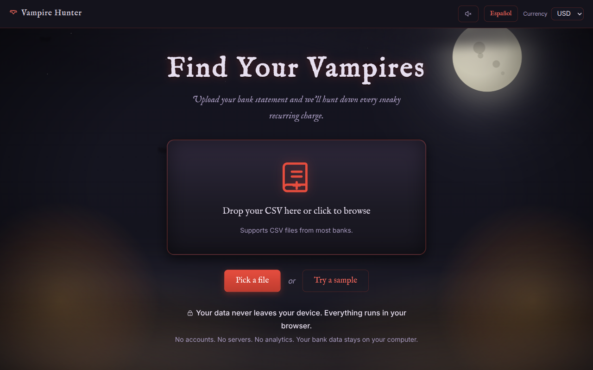
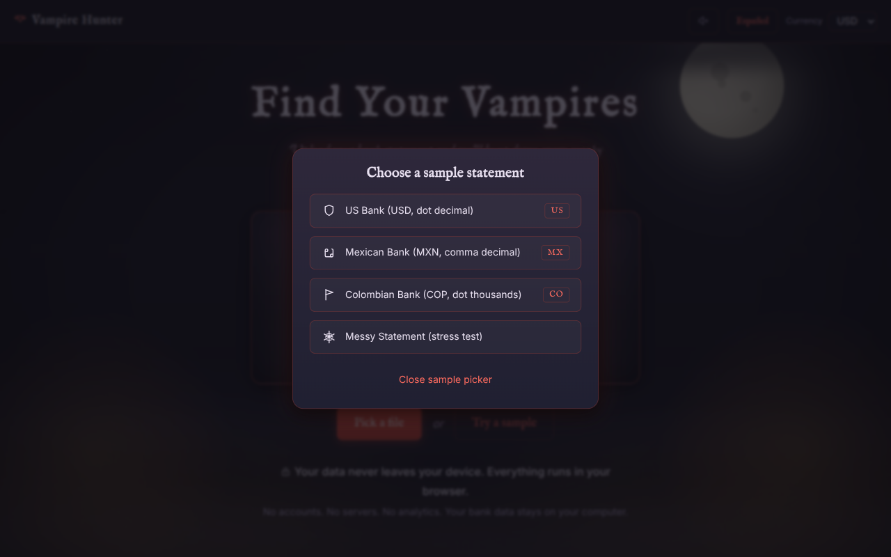
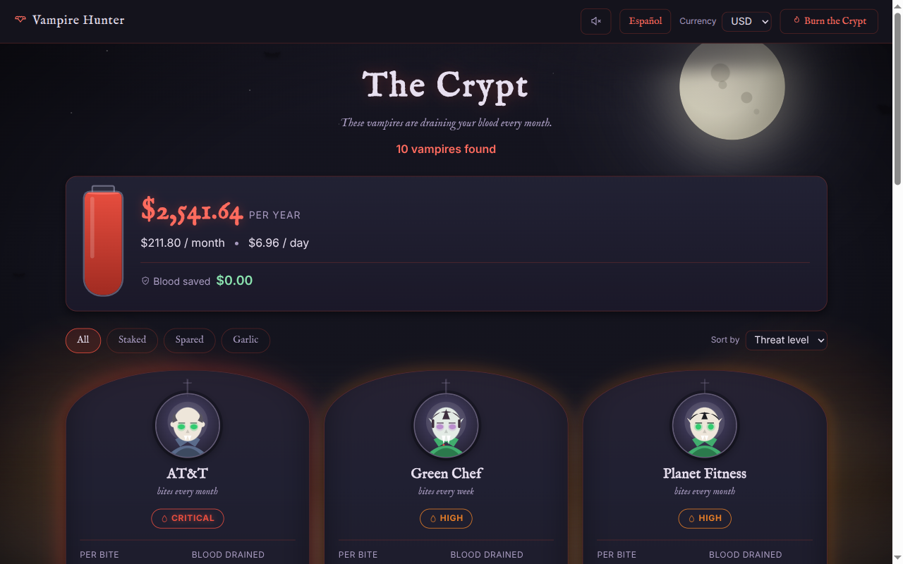
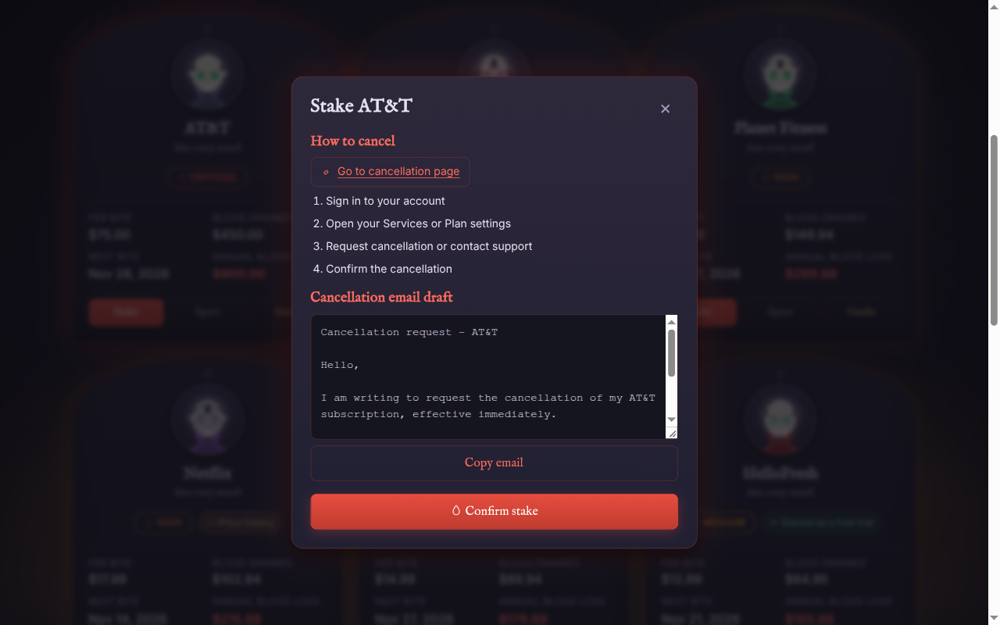
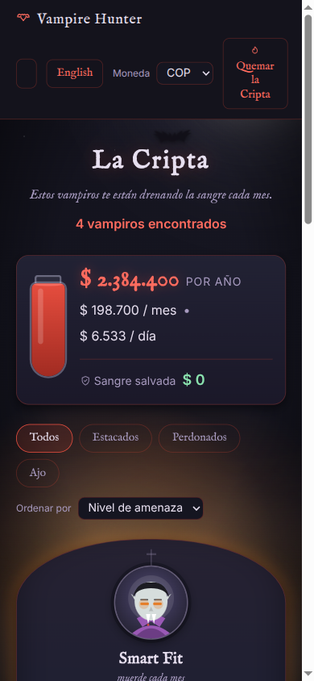
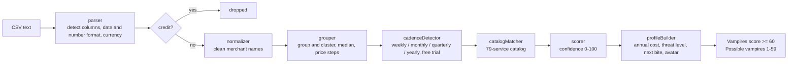

# Vampire Hunter

**Upload a bank statement, and watch the forgotten subscriptions that quietly drain your money show up as vampires in a haunted crypt. Then stake, spare, or garlic each one. Your data never leaves your browser.**

**Live demo:** https://main.d3ptany6mlf6dh.amplifyapp.com

Built for the Kiroween hackathon.



| Sample picker | The Crypt (US sample) |
|---|---|
|  |  |

| Stake modal | Mobile, Spanish, COP sample |
|---|---|
|  |  |

## The problem

Most of us pay for something we forgot about: a free trial that rolled into a paid plan, a streaming service nobody watches, a gym that charges every month. Each charge is small, so it slips by. Across a year it adds up. Bank statements don't help, because they are long lists of cryptic merchant names.

Vampire Hunter reads the statement for you and shows only the charges that repeat.

## How it works

1. **Upload a CSV.** Drop in a statement from your bank, or pick one of the five built-in samples (US/USD, Mexico/MXN, Colombia/COP, an Amex-style file where charges are positive, and a messy stress-test file).
2. **Detection.** The engine finds the date, description and amount columns, cleans up merchant names, groups similar charges, and keeps the ones that repeat weekly, monthly, quarterly or yearly.
3. **The Crypt.** Each recurring charge becomes a vampire card with its price per bite, total blood drained, next predicted bite, and annual blood loss. A blood meter adds it all up per year, month and day.
4. **Decide.** For every vampire you choose:
   - **Stake** (cancel): opens a modal with the cancel link, step-by-step instructions and a ready-to-copy cancellation email.
   - **Spare** (keep): you know about it and want it.
   - **Garlic** (reminder): downloads an `.ics` calendar file with an alert 3 days before the next charge. The app does not add anything to your calendar by itself. You open the file in Google Calendar, Apple Calendar or Outlook to add it. The button's help text says exactly this.

The theme maps directly to money terms: vampire = recurring charge, bite = one charge, blood drained = money spent, blood loss per year = annualized cost.

## Privacy

- Everything runs **100% in your browser**. There is no backend, no accounts and no analytics.
- Transaction data is never sent anywhere. The only `fetch` in the app loads the bundled sample CSVs from the same static site (`src/components/SamplePicker.tsx`).
- The only thing stored is in `localStorage`, under one key (`vampire-hunter:crypt`): your **decisions** (stake / spare / garlic), your **language** and your **currency**. No transactions are written (`src/engine/cryptStorage.ts`).
- The **Burn the Crypt** button wipes that storage and resets the app.

## Security & privacy

- **Content Security Policy** (`customHttp.yml`): the header sets `connect-src 'self'`, so the browser itself blocks any attempt to send data to another origin. Even a bug or a compromised dependency could not post your transactions elsewhere. `script-src 'self'` also rules out inline scripts and `eval`.
- **Avatars are images, not HTML:** each vampire avatar is an SVG data URI rendered in an `` tag. It is never injected as HTML, so merchant names from a CSV cannot run script.
- **Dependencies:** `npm audit` reports 0 vulnerabilities.
- **Exchange rates are approximate:** the static table in `src/data/exchangeRates.json` has an `asOf` date, shown next to the currency selector, and is only used to estimate threat levels.

## Features

- **Multi-currency:** display in USD, MXN, COP, ARS, CLP, EUR, BRL, GBP, CAD or PEN. The statement's currency is inferred from a currency column, ISO codes or symbols. Money is stored as integer cents.
- **Supported bank formats:** the parser is tested against synthetic exports in the style of these banks (`tests/fixtures/banks/`): American Express (US), Bancolombia (CO), Chase (US), ING (NL), Itaú (BR), Nubank (BR), Revolut (GB) and Santander (ES). If auto-detection isn't sure about a file from any other bank, the manual column mapper is the fallback: you pick the date, description and amount columns yourself.
- **Messy bank formats:** dates in DD/MM/YYYY, MM/DD/YYYY or YYYY-MM-DD, amounts with comma or dot decimals, single amount column or split debit/credit columns, and a manual column mapper when auto-detection isn't sure.
- **Latin-1 / Windows-1252 CSVs:** many European and Latin American banks export in these encodings. Files are decoded as UTF-8 first; if that is invalid, the browser's `TextDecoder` falls back to windows-1252, so accents like "PANADERÍA" and "Débito" survive. No network involved (`decodeCsvBytes` in `src/components/csvUtils.ts`, fixture in `tests/fixtures/encoding/`).
- **Bilingual:** English and Spanish with a one-click switch (`src/i18n/en.json`, `es.json`).
- **79-service catalog** (`src/data/catalog.json`) with names, aliases, cancel URLs and cancel steps.
- **Price-increase detection:** flags a sustained rise in a charge (2% or more).
- **Free-trial detection:** flags subscriptions that started as a free trial.
- **Confidence scoring:** score of 60 or more is a vampire; lower scores are kept as "possible vampires".
- **Threat levels** from Low to Critical, based on annual cost.
- **Calendar reminders:** RFC 5545 `.ics` files generated in the browser. They are a download only, nothing is added to a calendar automatically.
- **Gothic ambient sound (optional, off by default):** synthesized live with the Web Audio API (`src/audio/`), with no audio files. Layers are a pad, wind and a distant bell, plus sounds for stake, garlic and burn actions.
- **Accessibility:** labeled controls and cards, modals with a focus trap, Escape to close and focus return, and `prefers-reduced-motion` support for animations. Threat levels use text and icons, not color alone. Full WCAG validation would still need manual testing with assistive technologies.
- **Icons:** a custom inline-SVG icon set; a test (`tests/no-emoji.test.ts`) keeps emoji out of the UI.

## Engine pipeline

The detection engine lives in `src/engine/` as pure TypeScript with no React imports. `runDetection` and `parseStatement` in `src/engine/index.ts` wire the modules together and never throw.



Candidates with no detectable cadence (including one-off charges) or a score of 0 are excluded.

## Tech stack

- Vite + React 19 + TypeScript (strict)
- CSS Modules with CSS-variable design tokens (`src/styles/tokens.css`)
- Framer Motion for animation
- Papa Parse for CSV parsing
- Vitest + fast-check + Testing Library (jsdom)
- Oxlint
- Static hosting on AWS Amplify (`amplify.yml`)

## Run locally

Requires Node.js 22 (the Amplify build uses 22).

```bash
npm ci
npm run dev      # dev server
npm run build    # type-check + production build into dist/
npm run preview  # serve the build
npm run lint
```

Sample statements for trying the app are in `samples/` (fake data only).

## Tests

```bash
npm test         # vitest run
```

Last run of `npx vitest run`: **42 test files, 591 tests, all passing.**

The engine is covered by unit tests and by fast-check property tests (`tests/*.property.test.ts`, and property tests inside other test files; run counts per property are listed in [`PROPERTY_TEST_RESULTS.md`](PROPERTY_TEST_RESULTS.md)). There are also integration tests over the sample statements (`tests/integration.sampleStatements.test.ts`), over the bank fixtures (`tests/integration.bankFixtures.test.ts`), and UI tests for the burn flow, icons, garlic copy and sound.

## How Kiro was used

- **Specs** (`.kiro/specs/`, 4 specs, each with design and tasks):
  - `vampire-hunter/`: the full app: CSV parsing, detection engine, crypt UI, persistence, i18n.
  - `gothic-icons-and-burn-animation/`: the follow-up polish: custom SVG icon system replacing emoji, and the Burn the Crypt animation.
  - `ux-burn-garlic-sound-fixes/`: full-viewport burn overlay, honest Garlic help text, and the synthesized ambient sound.
  - `bank-format-parser-fixes/` (Bug Fix spec): see below.
- **Steering** (`.kiro/steering/`): `product.md` (promise, audience, tone, vampire vocabulary), `tech.md` (stack and hard rules such as no network calls with transaction data, integer cents, pure engine) and `structure.md` (folder layout).
- **Hooks** (`.kiro/hooks/run-engine-tests-on-save.json`): runs `npm test` whenever a file in `src/engine` or `tests` is saved, so failures show up immediately.
- **MCP** (`.kiro/settings/mcp.json`): the Playwright MCP server, used to drive the live site and capture the screenshots in `docs/screenshots/`.
- **Kiro CLI + custom agent `statement-tester`** (`.kiro/agents/statement-tester.json`): created with Kiro CLI. It writes realistic fake bank exports into `tests/fixtures/banks/` (it can't write to `src/`), runs them through the real engine with `scripts/detect.ts`, and reports expected vs detected. On its first run it detected 0 subscriptions on the raw bank formats. Later, 2 never-seen banks (Itaú BR and ING NL) exposed an overfitted parser. Both runs are documented in [`docs/kiro/statement-tester-runs.md`](docs/kiro/statement-tester-runs.md).
- **Bug Fix spec `bank-format-parser-fixes`** (`.kiro/specs/bank-format-parser-fixes/`): the bug-condition test was written first, and failed on the unfixed code. A baseline of the sample results (`tests/baselines/inAppSamples.vampireIds.json`) was captured before any fix, and a preservation test checks that the 5 in-app samples keep exactly those vampire ids. Kiro asked before adding a new rule instead of patching the parser on its own.
- **Property-based tests:** the properties in `tests/*.property.test.ts` found four real bugs that example tests missed: the normalizer wasn't idempotent (Property 1), small sustained price steps weren't flagged (12b), two subscriptions from the same merchant grouped differently depending on row order (3b), and some avatars rendered with `fill="undefined"` because of a signed bit shift (8b). All four were fixed. [`PROPERTY_TEST_RESULTS.md`](PROPERTY_TEST_RESULTS.md) records each property with its failing counterexample before the fix and the passing run after it.
- **Kiro IDE and Kiro Web together:** the IDE built the app task by task from the spec, while Kiro Web (the cloud agent) worked in parallel on separate branches and opened pull requests for property tests, catalog fixes and engine edge cases (bank-style negatives like `(15.49)`, ISO-only dates, phone and store numbers in merchant names, accent-insensitive matching). Every PR was reviewed and merged on GitHub.
- **Powers and tools used:**
  - **Aikido Security** (Kiro IDE): security scanning of the code and dependencies.
  - **ScoutQA:** automated exploratory testing of the live site.
  - **GitHub** (Kiro Web): the cloud agent's branches and pull requests.
- **Human + AI review:** each Kiro task was checked against real sample statements before merging. Review and small fixes were done with help from Claude Code, credited as co-author in those commits.

## License

[MIT](LICENSE)
